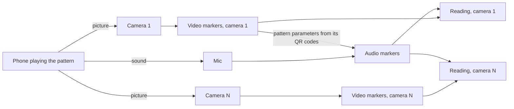
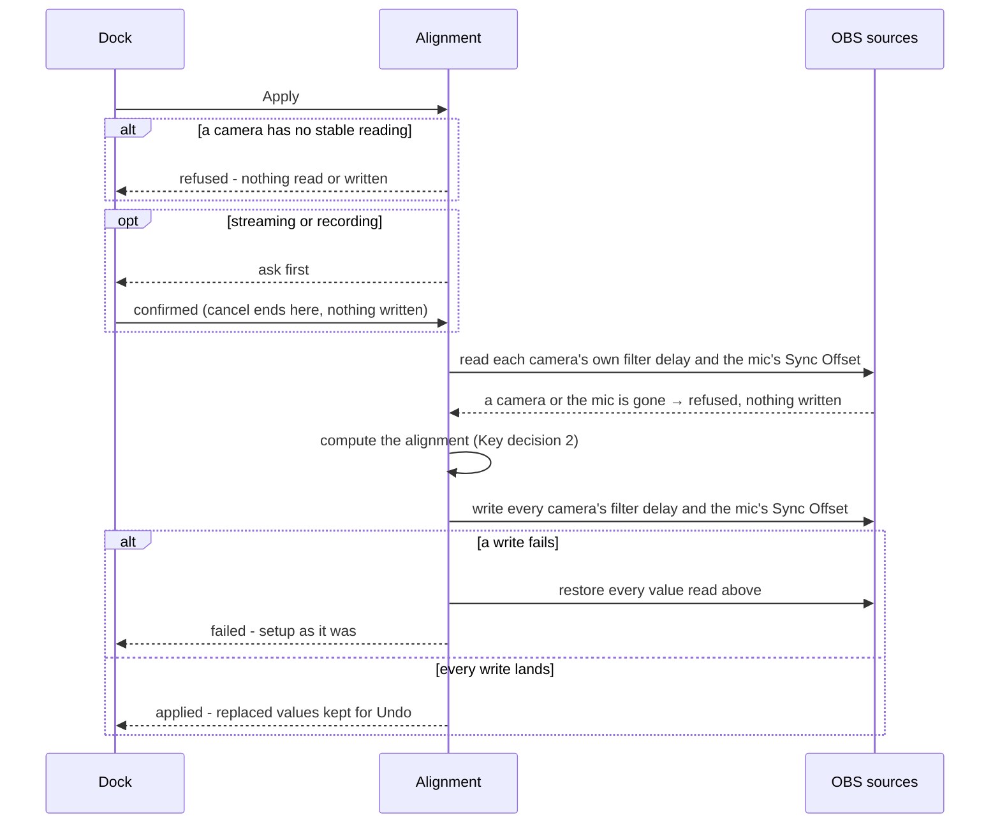

# Multi-Camera Sync

> Plan from this document. Each slice below carries its own shape - copy it, do not re-derive it.
> Status: confirmed by Vinicius Braz, 2026-10-11

## Situation

- Project: not shipped yet. The repository holds only `CLAUDE.md` and the skills, and there is no OBS machine to test on: the development machine is WSL with no OBS, CMake or cameras.
- Decision: open until this discovery; the verdict is the Status line.
- In flight: copies Audio Video Sync Dock's pattern and detector as precedent (Key decision 5). Klaps' echo-tolerant detector stays out unless the Reading spike calls for it.
- At stake: weeks of one developer's time and a public release. A wrong Apply edits users' scene collections, which Key decisions 1, 4 and 7 keep reversible.

## Problem

OBS users who run several cameras into one mic - podcasts, event and PTZ rigs - cannot align them inside OBS. Each camera reaches OBS with its own lag, and the mic's Sync Offset can match only one of them, so whichever camera is on air, the others are out of sync. What they do instead is a manual loop: record a clap, measure every camera against the mic in a video editor, delay each faster camera to match the slowest, offset the mic, and repeat whenever a camera changes. OBS forum threads show the loop going wrong - Render Delay put on cameras, users unaware that one camera can be delayed on its own, a request for a visual way to measure each source that nobody could answer - and the OBS Offset Calculator exists only to do the loop's arithmetic: 1,798 downloads in 13 months, no ratings, still clapper-and-editor. How long the loop takes is unmeasured; nobody publishes it, so the substitute is the evidence, not a number.

Users with one camera are served: the Sync Offset applies a known lag, Audio Video Sync Dock measures it (19,161 downloads), and its support thread and issue tracker hold measurement complaints and none about applying the result.

## Success

- Worked if: a user with two or more cameras and one mic aligns all of them in one measure-and-apply pass, without a video editor, after which every camera reads within one frame of the mic (~33 ms at 30 fps); and the plugin passes the OBS Offset Calculator's pace - about 1,800 downloads in its first 12 months.
- Going wrong: early forum reports of a camera that never got a reading in the user's first session - the complaint that dominates Sync Dock's support thread.
- Review: 3 months after the first forum release - Vinicius, from the forum thread and the download count.

## Boundary

In: two or more cameras and one mic in one OBS instance, each with a lag that holds steady; measuring with the pattern played on a phone; Apply and Undo; Windows, macOS and Linux builds.

Out:
- Drift during a session - the lag is fixed; correcting drift is continuous work and a different product.
- More than one mic - one mic is the timing reference; a second would need its own alignment against it.
- Measuring without a phone and the pattern - devices' own latency reports are unreliable, and no pattern-free detector exists to reuse.
- Screen, window and game captures - Video Delay (Async) cannot delay them.
- A camera's built-in mic as the reference - the chosen mic is the reference.
- Building for single-camera users - Sync Dock and Klaps serve them; one camera works, it is just not the target.

Unchanged: Render Delay is never added or edited; filters the user added are never edited, reordered or removed; scenes, audio tracks, the mic's other properties and every other source stay as they are.

## Prior art

- A coded pattern played on a phone - frames numbered by QR codes, sound pulses carrying the same numbers - timed on OBS's own frame and audio timestamps rather than arrival time; Sync Dock built it and Klaps kept it - we take it (Key decision 5).
- Detection fails in echoey rooms - Sync Dock's support thread, and the reason Klaps was forked - the Reading spike tests it before Alignment starts; an echo-tolerant detector is Shape's alternative.
- Corrections land in the wrong place - Render Delay on cameras in forum threads; Klaps' apply refuses unless exactly one audio source is on Track 1 - Key decisions 1 and 4 fix where Apply writes, and the mic is chosen, never inferred.
- Devices' own latency reports - forum answers say drivers report it unreliably - we measure, and never read it.
- Sync Dock and Klaps measure Program, so one camera at a time - the condition of theirs we do not share is a single camera (Key decision 6).
- The Offset Calculator aligns to a chosen master source and applies video corrections with Render Delay - we align to the slowest path with Video Delay (Async) (Key decision 2).

## Shape

One dock measures every selected camera against one mic at the same time while a phone plays Sync Dock's test video - the **pattern** - and turns the readings into an **alignment**: a delay for each camera and a Sync Offset for the mic, which one Apply writes into OBS's own settings and one Undo takes back. The doors are where the alignment lives (Key decision 1) and which pattern users play (Key decision 5): moving either later breaks setups or instructions already in users' hands, while everything else here can change between releases. This shape reuses a pattern and detector that already work for Sync Dock's users; it will not survive rooms where the phone cannot sit near the mic and echo swamps the pulses, which would force a new detector.

The heavier alternative is an echo-tolerant pattern and detector of our own, as Klaps built - it wins if the Reading spike shows Sync Dock's detector cannot hold a stable reading with the phone beside the mic in an ordinary room.

## Key decisions

1. **The alignment lives in OBS's own settings, never in the plugin.** Apply writes a Video Delay (Async) filter on each camera and the mic's Sync Offset, so the setup stays aligned with the plugin disabled, uninstalled, or the scene collection opened on a machine without it. Moving to a delay filter of the plugin's own later would leave users' scene collections pointing at a filter other machines do not have - the one change here that cannot be walked back.
2. **Every correction is a delay, and everything is aligned to the slowest path.** Faster cameras are delayed to match the slowest camera and the mic is delayed to match them; when the mic is the slowest - wireless, Bluetooth, network audio - the cameras are delayed to it instead of giving the mic a negative offset. No value Apply writes is negative, and the total added latency is the least that aligns every camera with the mic: OBS cannot make video earlier, and its negative Sync Offset stops at -950 ms.
3. **A reading is what Program would show if that camera were on air, with every current correction in place, and Apply adds to the current values instead of replacing them.** Measuring right after Apply reads about zero, applying twice converges instead of doubling, and delays the user set by hand are measured rather than overwritten. A tap that skips the camera's existing filters, or the mic's current Sync Offset, produces a number that means something else and must not be used.
4. **The plugin edits only the filter it created on each camera, and the mic's Sync Offset.** Its filter is found by name and created on the first Apply; filters the user added are never edited, reordered or removed, and their effect shows up in the reading (Key decision 3). When the alignment would need one of the user's own filters to shrink, Apply delays the others instead (Key decision 2).
5. **Users measure with Sync Dock's pattern and its detector is reused, so the plugin is GPL-2.0-or-later.** The pattern has the field record of Sync Dock's 19,161 downloads and users who already have it need nothing new; the detector is reworked to run once per camera instead of once on Program. The pattern is what users hold in their hands - changing it later means new media and new instructions - and the licence is fixed once others contribute.
6. **All selected cameras are measured in one pass, from one phone, against one mic.** Each camera produces its own reading at the same time; a camera that cannot see the phone is measured later by moving the phone, and readings persist until Apply, Reset or a scene collection switch. This is the promise Success is written against, and the Reading spike confirms whether it can be kept.
7. **Apply is all-or-nothing and can be undone.** It needs a stable reading for every selected camera, writes every correction or none - a failure partway restores what was there - and keeps the values it replaced for Undo. A half-applied alignment is worse than none: the cameras would disagree with each other on air.

## Work

| Slice | Delivers | Status |
|---|---|---|
| [Reading](#reading) | every selected camera's offset to the mic, measured at once while a phone plays the pattern | spike |
| [Alignment](#alignment) | Apply writes the corrections into OBS's own settings in one step; Undo puts back what was there | open — 3 defaults taken |
| [Release](#release) | installable builds for Windows, macOS and Linux, published on the OBS forum with the pattern | open — 4 defaults taken |

Order: Reading (its spikes first, on the test rig) → Alignment → Release.

Already handled by existing code: a camera that carries its own audio, such as HDMI audio on a capture card → OBS delays that audio together with the source's delayed video; the plugin disabled or removed → OBS keeps applying the filters and the Sync Offset it wrote.

Derivable from the repository, left to the plan: build, CI, packaging and code layout - all as OBS's official plugin template does them; dock registration, locale strings and pattern generation - as Sync Dock does them; commit messages - as `CLAUDE.md` says.

### Reading

**Delivers** every selected camera's **reading** - the milliseconds by which its video trails (+) or leads (−) the mic's audio - measured at once while a phone plays the pattern. **Status: spike.** Holds Key decision 6.

| State | What should happen | Dock shows |
|---|---|---|
| Dock opened | Video sources Video Delay (Async) can delay - webcams, capture cards, media sources - are listed as cameras, those in the current Program scene preselected; audio sources are listed for the mic, preselected only when exactly one audio input exists | camera checklist, mic picker, link to the pattern |
| Start with no camera or no mic chosen | Not started | Start disabled - "Pick at least one camera and the mic" |
| A camera has not seen the pattern | No reading for it; the other cameras carry on | "Looking for the pattern" on that camera |
| Cameras see the pattern, the mic hears nothing | No readings - every reading needs the mic's markers | "No pattern sound from {mic} - bring the phone closer or unmute it" |
| A camera's markers disagree by more than one frame | Keep measuring; its reading is not stable | the live value, marked "settling" |
| A camera's last five markers agree within one frame | Its reading is stable and kept | "+142 ms - video late" or "−60 ms - video early" |
| A camera with a stable reading loses the pattern | Its reading is kept (Key decision 6) | the value, unchanged |
| A selected camera is removed, renamed or deactivated | Its reading is dropped | the camera leaves the list |
| Stop, Reset, or scene collection switched | Stop keeps the readings; Reset and a collection switch clear them | - |

Each camera's markers are taken where Program would see them and the mic's after its Sync Offset (Key decision 3); where exactly that tap sits is the first spike. The mic's audio markers can only be decoded with parameters read from the pattern's QR codes - Sync Dock's detector is built that way - so audio decoding starts once any camera has decoded them.

- Spike: where must each camera's tap sit for its reading to equal what Program shows for that camera, with every camera measured at once - a measuring filter at the end of each camera's filter chain, or a private video mix per camera measured the way Sync Dock measures Program? - one of them matching → Key decision 6 holds as written; neither → readings come from Program one camera at a time, the dock walks the user through the cameras, and Success's "one pass" becomes "one session" - stops when two cameras with different lags each read within one frame of Sync Dock's own reading for that camera, three runs in a row, or after three working days on the test rig.
- Spike: does Sync Dock's detector hold a stable reading with the phone within arm's reach of the mic in an ordinary untreated room? - yes → Key decision 5 stands; no → Shape's alternative replaces the detector before Alignment starts - stops after three runs at each of two phone distances.

Both spikes need the test rig: two cameras with different lags (a phone webcam app can be the second), a mic, and a phone to play the pattern.

Alternatives considered: devices' own latency reports instead of a pattern - wins if devices reported latency reliably; forum answers say they do not.

### Alignment

**Delivers** the alignment - a delay for each camera and a Sync Offset for the mic - written by Apply in one step and taken back by Undo. **Status: open.** Holds the door in Key decision 1.

| State | What should happen | Dock shows |
|---|---|---|
| A selected camera has no stable reading | Apply refused; nothing written | Apply disabled - "Waiting for {camera}" |
| Every camera already within one frame of the mic | Nothing to write | "Already aligned" |
| Streaming or recording is active | Apply asks first; cancelling writes nothing (default 2) | "Shift {n} cameras and the mic while on air?" |
| A correction would pass OBS's limits - 20,000 ms of video delay or Sync Offset | Refused; nothing written | "{camera} needs more delay than OBS allows" |
| Apply succeeds | Every correction written (Key decisions 1, 2, 4); the replaced values kept for Undo; readings cleared and measuring resumes | each camera's delay and the mic's offset |
| A write fails partway - a source vanished | Every value restored (Key decision 7) | "Apply failed - nothing changed" |
| Re-measured after Apply, every camera within one frame | Aligned | "Aligned", each camera ticked |
| Re-measured after Apply, a camera still off | Apply again adds the remainder (Key decision 3) | the reading, as in Reading |
| Undo | Restores exactly the values from before the last Apply | the restored values |
| Undo after OBS was restarted | Not offered (default 1) | Undo disabled |

What Apply writes:

| Where | What | Written by | Note |
|---|---|---|---|
| each camera's filters | a Video Delay (Async) filter named "Camera Sync Delay" | Apply - created on the first Apply, edited after | the only filter the plugin touches (Key decision 4) |
| the mic's Advanced Audio Properties | Sync Offset, in ms | Apply | never negative after Apply (Key decision 2) |
| plugin settings, per scene collection | the chosen cameras and mic | the dock | the selection comes back next time |

Open, default taken:
1. How far back Undo reaches - one Apply, for the current OBS session; after a restart the earlier values are gone, though every value stays visible in OBS's own dialogs.
2. Apply while streaming or recording - allowed after a confirmation; blocking would force a stream to stop to fix sync.
3. The plugin's filter name - "Camera Sync Delay", following the product name once chosen (Release default 4).

### Release

**Delivers** installable builds for Windows, macOS and Linux, built in CI and published as an OBS forum resource with the pattern and a how-to. **Status: open.**

| State | What should happen | User sees |
|---|---|---|
| Windows user installs | An installer puts the plugin in place | the dock under Docks |
| macOS user installs | An unsigned package, with the Gatekeeper steps documented (default 1) | a macOS warning once, then the dock |
| Ubuntu user installs | A .deb package | the dock under Docks |
| OBS installed from Flatpak | Not supported in the first release (default 2) | the forum page says so |
| OBS older than the minimum | The plugin does not load; the forum page states the minimum (default 3) | - |
| User needs the pattern | Pattern files for common frame rates ship with every release, generated with Sync Dock's tool | download links on the forum page and in the dock |

Open, default taken:
1. macOS builds - unsigned at first, with install steps documented; signing needs a paid Apple developer account. Revisit if macOS users report install trouble.
2. Flatpak - later; OBS's Flatpak build runs plugins inside its own runtime, so it needs a separate package.
3. Minimum OBS - 30.0, matching Sync Dock; raised only if the tap the Reading spike picks needs a newer OBS.
4. Product name - working name "Camera Sync" until one is chosen.

## Sources

- [Audio Video Sync Dock - forum resource](https://obsproject.com/forum/resources/audio-video-sync-dock.2028/) - 19,161 downloads, Windows/macOS/Linux, OBS 30.0+, measures and displays only.
- [Audio Video Sync Dock - support thread](https://obsproject.com/forum/threads/audio-video-sync-dock.181514/) - five user reports: four about measuring, one about installing, none about applying.
- [norihiro/obs-audio-video-sync-dock](https://github.com/norihiro/obs-audio-video-sync-dock) and [issue #13](https://github.com/norihiro/obs-audio-video-sync-dock/issues/13) - the detector measures Program on OBS's own timestamps, tracks one pattern per instance, and is GPL-2.0-or-later; the maintainer scopes it to measuring what is about to be encoded.
- [matiaspl/klaps](https://github.com/matiaspl/klaps) - echo-tolerant detection; Correct Sync Offset writes only when exactly one audio source is on Track 1.
- [OBS Offset Calculator](https://obsproject.com/forum/resources/obs-offset-calculator.2209/) - the manual multi-source workflow; 1,798 downloads in 13 months, no ratings.
- OBS forum threads: [multiple cameras, different delay times](https://obsproject.com/forum/threads/multiple-cameras-different-delay-times.120646/), [three inputs of a Duo 2 card](https://obsproject.com/forum/threads/obs-has-wildly-different-video-delay-among-3-inputs-of-duo-2-card.154900/), [HDMI and NDI latencies](https://obsproject.com/forum/threads/how-to-synchronize-video-from-multiple-sources-with-different-latencies-hdmi-ndi.185745/), [two-camera sync](https://obsproject.com/forum/threads/two-camera-audio-video-sync.174739/), [multiple PTZ cameras](https://obsproject.com/forum/threads/using-multiple-ptz-cameras-and-obs-video-delay.133790/), [a visual way to sync](https://obsproject.com/forum/threads/visual-way-to-sync-up-video-audio.149304/) - the multi-camera loop and how it goes wrong.
- OBS source: [Video Delay (Async)](https://github.com/obsproject/obs-studio/blob/master/plugins/obs-filters/async-delay-filter.c) - 0 to 20,000 ms, async sources only, a source's own audio follows its video; [Advanced Audio Properties @ 30.2.0](https://github.com/obsproject/obs-studio/blob/30.2.0/UI/adv-audio-control.cpp) - Sync Offset from -950 to 20,000 ms.
