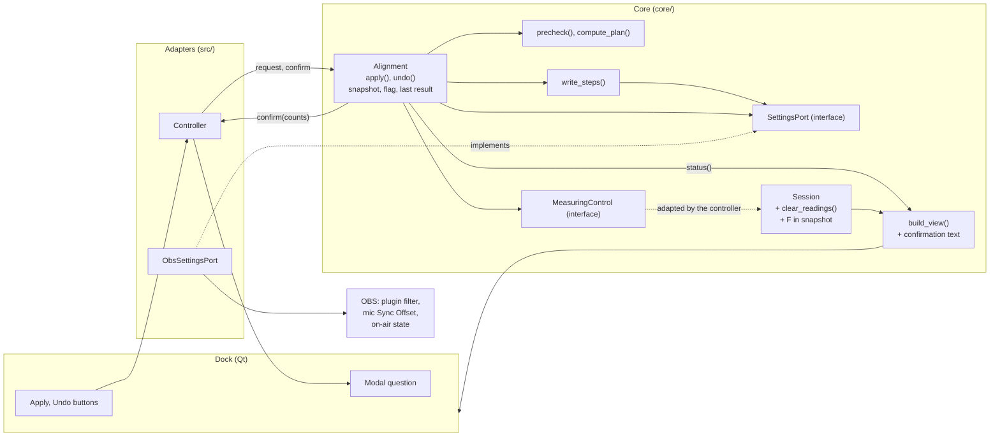

# Alignment Design

**Spec**: `.specs/features/alignment/spec.md`
**Context**: `.specs/features/alignment/context.md`
**Status**: Approved by the maintainer, 2026-10-20

Approaches considered: a one-call `Alignment` with the on-air question as a callback (chosen by the maintainer, 2026-10-20), a two-phase prepare and commit, and Apply inside the Session. Integration tests compile OBS 30.0.2's own Video Delay (Async) into the test executable (chosen by the maintainer, 2026-10-20; ALIGN-77 reworded to match).

No `.specs/STATE.md` exists, so no `AD-NNN` decision constrains this design; the ADRs in `docs/adr/` do, as the TDD says. No confirmed lessons exist.

---

## Architecture Overview

Every rule stays in the OBS-free core, as Reading's do. A pure calculator decides the plan. One routine, `write_steps`, writes a list of target values, reads each back, and on failure puts back every value it changed in reverse order; Apply, Undo and both restores run through it. An `Alignment` object owns what lives between clicks, the Undo snapshot, the "aligned after Apply" flag and the last result, and runs `apply()` and `undo()` each in one call on the UI thread. The on-air question is a callback that call makes, which the controller answers through the dock's modal dialog. The core reaches OBS only through `SettingsPort`, whose OBS implementation is the one new adapter.



Apply, in the order the spec fixes (ALIGN-11 to ALIGN-30):

```mermaid
sequenceDiagram
  participant C as Controller
  participant A as Alignment
  participant K as precheck / compute_plan
  participant P as SettingsPort
  participant W as write_steps
  participant M as MeasuringControl
  C->>A: apply(request, confirm)
  A->>K: precheck(readings, F)
  alt waiting or already aligned
    A-->>C: refused - nothing resolved, read or written
  end
  A->>P: resolve every source, delay filter available?
  A->>P: read filters and Sync Offset (restore point)
  A->>K: compute_plan(readings, filters, offset)
  alt over the limit
    A-->>C: refused - nothing written
  end
  opt on air
    A->>C: confirm(counts)
    Note over C: modal dialog; OBS's event loop keeps running
    C-->>A: yes / no (no ends here)
    A->>P: resolve and read again; generation unchanged?
  end
  A->>W: steps for the changed values, cameras then mic
  alt a write or read-back fails
    W->>P: put back every changed value, reverse order
    A->>M: clear_readings() (a write was attempted)
    A-->>C: failed / restore failed
  else every write lands
    A->>M: clear_readings(), resume(rate) if Stopped
    A-->>C: applied - restore point kept for Undo
  end
```

---

## Code Reuse Analysis

### Existing Components to Leverage

| Component | Location | How to Use |
| --------- | -------- | ---------- |
| `round_half_away`, `frame_interval_ms` | `core/reading/pattern.hpp:29`, `:32` | Rounding s to whole ms and the restored offset in "Undone - ..." (ALIGN-04, ALIGN-55); F is the one Reading computes |
| `Session::start(FrameRate)` | `core/reading/session.cpp:93` | Resuming a Stopped session after Apply; Start in Stopped keeps every reading and the pattern (READ-26), so Apply clears first and starts second |
| `Session::on_mic_sync_offset_changed` | `core/reading/session.cpp:196` | Already clears every reading and keeps the pattern; the new `clear_readings()` is that body, and the handler calls it |
| `CameraRow`, `CameraState`, `SessionSnapshot` | `core/reading/estimator.hpp`, `core/reading/session.hpp:52` | The calculator's readings: `state == Stable`, `reading_ms` |
| `camera_list` | `core/selection/selection-policy.hpp:44` | Checklist order (alphabetical, ignoring case) for the request's cameras, "Waiting for {camera}", the write order and the message values |
| `Clock`, `Logger`, `write_log`, `quote` | `core/reading/camera-pipeline.hpp:16`, `core/log.hpp`, `core/log-lines.hpp` | `duration_ms`, every log line, and READ-88's quoting for ALIGN-76 |
| `strings::fill`, `all_keys`, the locale test | `core/viewmodel/strings.hpp`, `tests/viewmodel/strings.cpp` | Every new string goes through a key; the existing test checks the new keys against `en-US.ini` (ALIGN-63) once `all_keys` lists them |
| `format_signed_ms` | `core/viewmodel/view-model.hpp:45` | The row text the check mark is put in front of (ALIGN-58) |
| `message_text` | `core/viewmodel/view-model.cpp:61` | Extended with the precedence of ALIGN-60, keeping its three Reading messages on top |
| The Reading test harness pattern | `tests/reading/session.cpp:51-190` | `FakeClock` and the recording `FakeLog` style for `FakePort`, `FakeMeasuring` and the alignment tests |
| `ObsCallbacks` queueing | `src/controller.cpp:72-133` | Unchanged. Apply's own writes fire `filter_add`, `filter_remove` and `audio_sync`; they arrive queued, after Apply has cleared the readings itself |
| OBS 30.0.2 sources in `.deps/` | `cmake/linux/buildspec.cmake:52-58` | The Ubuntu build already downloads them; the integration test compiles `plugins/obs-filters/async-delay-filter.c` from there |

### Integration Points

| System | Integration Method |
| ------ | ------------------ |
| Plugin filter | `obs_source_enum_filters` in chain order, matching `obs_source_get_unversioned_id == "async_delay_filter"` and a recognised name; `obs_source_create("async_delay_filter", name, settings, nullptr)` then `obs_source_filter_add`, which appends at the end of the chain (libobs inserts at `filters.array[0]`, which `enum_filters` visits last); `obs_source_update` with `delay_ms`; `obs_source_set_enabled`; `obs_source_filter_remove` |
| Filter availability | `obs_source_get_display_name("async_delay_filter") != nullptr`. Without obs-filters, `obs_source_create` still returns a placeholder that `obs_source_filter_add` accepts and that delays nothing, so this check is what makes ALIGN-14 true |
| Mic Sync Offset | `obs_source_get_sync_offset`, `obs_source_set_sync_offset` (ns). libobs emits `audio_sync` before storing the value, and a handler may rewrite it, so the read-back matters |
| On air | `obs_frontend_streaming_active() \|\| obs_frontend_recording_active()`; recording stays active while paused (`UI/api-interface.cpp:307-326` at 30.0.2). Injected into `ObsSettingsPort` as a function, so the adapter builds without the frontend in the integration tests |
| Canvas frame rate | `obs_get_video_info`, as Start already does (`src/controller.cpp:190`), for resuming after Apply |
| Session | `clear_readings()` and `start()`, through `MeasuringControl`, which the controller adapts |
| Dock | `ViewSink::confirm(question, detail)` shows a `QMessageBox` with "Apply" and "Cancel"; two new buttons forward to `Controller::apply()` and `Controller::undo()` |

---

## Components

### Alignment types

- **Purpose**: The plain data the calculator, `Alignment` and the view-model share, so the view-model needs no `Alignment` class.
- **Location**: `core/alignment/types.hpp`
- **Interfaces**: see Data Models (`FilterState`, `NamedSource`, `Counts`, `OutcomeKind`, `Outcome`, `AlignmentStatus`).
- **Dependencies**: `reading/types.hpp` for `SourceId`.
- **Reuses**: nothing new.

### Settings port

- **Purpose**: The only way the core touches OBS: the plugin filter of a camera and the mic's Sync Offset, nothing else (ALIGN-41).
- **Location**: `core/alignment/settings-port.hpp`
- **Interfaces**:
  - `bool resolves(const SourceId &source)` - the source exists.
  - `bool delay_filter_available()` - Video Delay (Async) is registered.
  - `std::optional<FilterState> read_filter(const SourceId &camera)` - absent or present with delay and enabled state; none when the camera is gone.
  - `bool write_filter(const SourceId &camera, int64_t delay_ms, bool enabled)` - creates the filter at the end of the chain when absent.
  - `bool remove_filter(const SourceId &camera)` - removes the plugin filter; true when there is none.
  - `std::optional<int64_t> read_sync_offset_ns(const SourceId &mic)` - none when the mic is gone.
  - `bool write_sync_offset_ns(const SourceId &mic, int64_t ns)`
  - `bool on_air()`
  - `inline constexpr std::array<const char *, 1> recognised_filter_names = {"Camera Sync Delay"}`; the first entry is the name a new filter gets (ALIGN-42).
- **Dependencies**: Alignment types.
- **Reuses**: the abstract-interface pattern of `TapFactory` (`core/reading/tap.hpp`).

### Calculator

- **Purpose**: Turn readings and current values into a plan or a refusal; pure, so the same inputs give the same output (story 1).
- **Location**: `core/alignment/calculator.hpp`, `.cpp`
- **Interfaces**:
  - `Precheck precheck(const std::vector<Reading> &readings, double frame_interval_ms)` - `Waiting` with the index of the first camera that is not Stable (ALIGN-01), `AlreadyAligned` when every reading is within ±F (ALIGN-02), `Ready` otherwise. Takes no current value, so ALIGN-11 and ALIGN-12 hold structurally: Apply calls it before resolving or reading anything.
  - `PlanResult compute_plan(const std::vector<int64_t> &readings_ms, const std::vector<FilterState> &filters, int64_t sync_offset_ns)` - effective delays (ALIGN-03), Δ (ALIGN-04), new values (ALIGN-05), the limit with the first source over it (ALIGN-07), changed flags (ALIGN-09).
- **Dependencies**: Alignment types, `round_half_away`.
- **Reuses**: `core/reading/pattern.hpp`.

### write_steps

- **Purpose**: Write a list of target values in order, read each back, and on the first failure put back every value it changed, in reverse order, continuing past failures while putting back (ALIGN-20, ALIGN-24 to ALIGN-26, ALIGN-36 to ALIGN-39).
- **Location**: `core/alignment/write-steps.hpp`, `.cpp`
- **Interfaces**:
  - `StepsResult write_steps(SettingsPort &port, const std::vector<Step> &steps)` - each `Step` names a camera with a target `FilterState` (present → `write_filter`, absent → `remove_filter`) or the mic with a target in ns, and carries the value it found there, which a failure puts back. The failed step itself is put back too, since a write can half-land (a filter created whose delay reads back wrong).
- **Dependencies**: Settings port.
- **Reuses**: nothing; one routine serves Apply, Undo and both restores, as the TDD asks ("the same resolve, write, verify and restore path").

### Alignment

- **Purpose**: Run Apply and Undo, each in one call, and keep what lives between clicks: the Undo snapshot, the "aligned after Apply" flag and the last result (stories 2, 3).
- **Location**: `core/alignment/alignment.hpp`, `.cpp`
- **Interfaces**:
  - `Alignment(SettingsPort &port, MeasuringControl &measuring, Clock clock, Logger log)`
  - `Outcome apply(const AlignmentRequest &request, const Confirm &confirm)` - the TDD's steps, with the question after the plan (`context.md`). After a yes it resolves and reads again and refuses if anything differs or the collection changed (ALIGN-19).
  - `Outcome undo(const AlignmentRequest &request, const Confirm &confirm)` - the snapshot's sources, names and order; the request supplies the session state and frame rate only.
  - `void collection_changing()` - drops the snapshot, the flag and the last result, and bumps the generation counter a pending question checks (ALIGN-32).
  - `void reset()` - drops the flag and the last result; the snapshot stays (ALIGN-57, ALIGN-58).
  - `AlignmentStatus status() const` - for the view-model.
  - `class MeasuringControl { virtual void clear_readings() = 0; virtual void resume(FrameRate rate) = 0; }` - declared here; the controller implements it over the session.
  - `using Confirm = std::function<bool(const Counts &)>;`
- **Dependencies**: Settings port, calculator, `write_steps`, `MeasuringControl`, `Clock`, `Logger`, the new log lines.
- **Reuses**: the `Session` constructor's injected `Clock` and `Logger` style.

### Session changes

- **Purpose**: Let Apply and Undo clear the readings while keeping the pattern, and expose F.
- **Location**: `core/reading/session.hpp`, `.cpp`
- **Interfaces**:
  - `void clear_readings()` - every camera back to Looking, the pattern kept; `on_mic_sync_offset_changed()` calls it.
  - `SessionSnapshot::frame_interval_ms` - the F read at the last Start, 0 before any Start.
- **Dependencies**: unchanged.
- **Reuses**: `estimator_.clear()`, `estimator_.set_frame_interval_ms`.

### Log lines

- **Purpose**: The lines of story 7, formatted in the core.
- **Location**: `core/log-lines.hpp`, `.cpp` (next to `measure_start`)
- **Interfaces**: `alignment_plan(prefix, cameras, mic)`, `alignment_ok(prefix, written, skipped, duration_ms)`, `alignment_failed(prefix, step, restored)`, `restore_failed_camera(name, intended, actual)`, `restore_failed_mic(name, intended_ns, actual_ns)`, `alignment_refused(prefix, reason, detail)`, `alignment_event(prefix, event)` for `already_aligned` and `cancelled`. `prefix` is `"apply"` or `"undo"` (ALIGN-75).
- **Dependencies**: `quote`.
- **Reuses**: `core/log-lines.cpp`.

### View-model changes

- **Purpose**: Apply and Undo buttons, the check marks, "Aligned", every result message, the precedence, and the question's text (story 5).
- **Location**: `core/viewmodel/view-model.hpp`, `.cpp`, `core/viewmodel/strings.hpp`, `data/locale/en-US.ini`
- **Interfaces**:
  - `DockView` gains `apply_enabled`, `undo_enabled`.
  - `build_view(snapshot, sources, choice, details, translate, const AlignmentStatus &alignment = {})` - the default keeps every Reading test call as it is.
  - `std::string confirmation_question(const Counts &counts, const Translate &translate)` - the five wordings (ALIGN-61).
  - `std::string confirmation_detail(const Counts &counts, const Translate &translate)` - the pause sentence, or empty when no camera changes (ALIGN-62).
  - `std::string format_value_ms(int64_t ms)` - "60", "0", "−200" (ALIGN-54, ALIGN-55).
- **Dependencies**: Alignment types, `camera_list`, the calculator's `precheck` (the same rule enables Apply as guards it).
- **Reuses**: `message_text`, `status_text`, `strings::fill`.

### ObsSettingsPort

- **Purpose**: `SettingsPort` over libobs (story 4).
- **Location**: `src/obs/obs-settings-port.hpp`, `.cpp`
- **Interfaces**: `explicit ObsSettingsPort(std::function<bool()> on_air)` plus the port's operations.
- **Dependencies**: libobs only; the frontend reaches it through the injected `on_air`.
- **Reuses**: the UUID lookup and release pattern of `src/controller.cpp:46-53`.

### Controller and dock changes

- **Purpose**: Wire the buttons and the question, and feed the view-model.
- **Location**: `src/controller.hpp`, `.cpp`, `src/camera-sync-dock.cpp`
- **Interfaces**:
  - `Controller::apply()`, `Controller::undo()` - build an `AlignmentRequest` (the ticked cameras in `camera_list` order with their names, the mic, `session_.snapshot()`, the canvas rate) and call `alignment_`. The `Confirm` passed builds the text with `confirmation_question` and `confirmation_detail` and asks `sink_->confirm`; with no dock it answers no.
  - `on_collection_changing()` and `reset()` also call `alignment_.collection_changing()` and `alignment_.reset()`.
  - `refresh()` passes `alignment_.status()` to `build_view`.
  - `ViewSink::confirm(const std::string &question, const std::string &detail) -> bool`.
  - The dock adds Apply and Undo after Reset in the button row, and its `confirm` runs a `QMessageBox` titled with the dock's title.
- **Dependencies**: `ObsSettingsPort`, `Alignment`, the session.
- **Reuses**: the existing button wiring (`src/camera-sync-dock.cpp:125-127`).

### Integration tests

- **Purpose**: Prove `ObsSettingsPort`, and Apply and Undo through it, against a real libobs (story 8).
- **Location**: `tests/integration/` (`main.cpp`, `obs-env.hpp`, `settings-port.cpp`, `alignment.cpp`, `CMakeLists.txt`)
- **Interfaces**: a doctest executable `camera-sync-integration-tests`, built only in Linux plugin builds. It starts libobs once on first use (so `--list-test-cases`, which `doctest_discover_tests` runs at build time, starts nothing), registers OBS 30.0.2's `async_delay_filter` compiled from `.deps`, a test async-video input for cameras, a test audio input for the mic, a test effect filter registered as `gpu_delay` for Render Delay, and another test filter type to carry a recognised name. A stub `obs_module_text` returns its key.
- **Dependencies**: libobs from `.deps`, the core, `src/obs/obs-settings-port.cpp`.
- **Reuses**: `third_party/doctest`, `doctest_discover_tests`.

---

## Data Models

```cpp
// core/alignment/types.hpp
struct FilterState {             // a camera's plugin filter
	bool present = false;
	int64_t delay_ms = 0;        // as read; meaningful when present
	bool enabled = true;
	bool operator==(const FilterState &) const;   // present, delay_ms and enabled
	int64_t effective_ms() const;                 // delay_ms when present and enabled, 0 otherwise (ALIGN-03)
};

struct NamedSource {
	SourceId id;
	std::string name;
};

struct Counts {                  // what a question counts (ALIGN-61)
	size_t cameras = 0;          // cameras whose value changes
	bool mic = false;            // the mic's value changes
};

enum class OutcomeKind {
	Waiting, AlreadyAligned, OverLimit, Cancelled,
	ApplyFailed, ApplyRestoreFailed, Applied,
	UndoFailed, UndoRestoreFailed, Undone,
};

struct NamedValue {
	std::string name;
	int64_t ms = 0;
};

struct Outcome {
	OutcomeKind kind = OutcomeKind::Waiting;
	std::string source;              // Waiting, OverLimit: the named camera or mic
	std::vector<NamedValue> values;  // Applied, Undone: the cameras in order, then the mic
};

struct AlignmentStatus {
	bool undo_available = false;
	bool aligned_after_apply = false;   // ALIGN-58
	std::optional<Outcome> last;        // the message line's result; never Waiting or Cancelled
};

// core/alignment/calculator.hpp
struct Reading { bool stable = false; int64_t ms = 0; };
enum class PrecheckKind { Ready, Waiting, AlreadyAligned };
struct Precheck { PrecheckKind kind; size_t camera = 0; };   // camera: the first not Stable, for Waiting

struct CameraPlan {
	int64_t old_ms = 0;   // effective delay
	int64_t new_ms = 0;
	bool changed = false;
};
struct Plan {
	int64_t delta_ms = 0;
	std::vector<CameraPlan> cameras;   // the request's order
	int64_t old_offset_ms = 0;         // s, rounded
	int64_t new_offset_ms = 0;
	bool mic_changed = false;
};
struct PlanResult {
	std::optional<Plan> plan;
	std::optional<size_t> over_limit;  // index into the cameras; cameras.size() names the mic
	int64_t over_limit_ms = 0;
};

// core/alignment/write-steps.hpp
struct Step {
	bool mic = false;
	SourceId source;
	std::string name;
	FilterState camera_target, camera_found;   // cameras
	int64_t mic_target_ns = 0, mic_found_ns = 0;  // the mic
};
struct RestoreFailure { size_t step; FilterState camera_actual; int64_t mic_actual_ns = 0; };
struct StepsResult {
	bool ok = true;
	size_t written = 0;               // steps attempted, the failed one included
	std::optional<size_t> failed;     // the step that failed
	std::vector<RestoreFailure> restore_failures;
};

// core/alignment/alignment.hpp
struct AlignmentRequest {
	std::vector<NamedSource> cameras;   // ticked, checklist order
	std::optional<NamedSource> mic;
	SessionSnapshot session;            // readings, state, F
	FrameRate rate;                     // to resume a Stopped session
};

struct UndoSnapshot {                   // in memory only (ALIGN-32)
	std::vector<std::pair<NamedSource, FilterState>> cameras;  // Apply's order
	NamedSource mic;
	int64_t sync_offset_ns = 0;         // to the nanosecond
};
```

**Relationships**: `Plan` indexes match `AlignmentRequest::cameras`. Apply builds one `Step` per changed camera and one for a changed mic, with the target from the plan (`{present, new_ms, enabled}`, the mic at `new_offset_ms × 1,000,000`) and the found value from the restore point. Undo builds one per value that differs between the snapshot and what it reads now. The restore point becomes the `UndoSnapshot` on success.

What sets and clears each piece of `Alignment`'s state:

| State | Set by | Cleared by |
| ----- | ------ | ---------- |
| Undo snapshot | A successful Apply (replacing any earlier one) | A successful Undo, a collection switch, a failed restore in Apply or Undo, the object's end at exit |
| Aligned after Apply | A successful Apply | Undo, Reset, a collection switch, a failed restore |
| Last result | Every Apply or Undo result except Waiting and Cancelled | Reset, a collection switch |
| Generation | - | Incremented by a collection switch; `apply()` and `undo()` compare it after a question |

---

## Error Handling Strategy

| Error Scenario | Handling | User Impact |
| -------------- | -------- | ----------- |
| A ticked camera not Stable | `precheck` → Waiting; nothing resolved, read or written; Warning `apply.refused reason=waiting` | Apply disabled, "Waiting for {camera}" |
| Every reading within ±F | `precheck` → AlreadyAligned; Info `apply.already_aligned` | "Already aligned" |
| A camera or the mic does not resolve | Refused before reading; Warning `reason=source_gone source="<uuid>"` | "Apply failed - nothing changed" |
| Video Delay (Async) not registered | Refused before reading; Warning `reason=no_delay_filter` | "Apply failed - nothing changed" |
| A value above 20,000 ms | `compute_plan` → over limit; Warning `reason=over_limit` | "{camera} needs more delay than OBS allows" |
| Question cancelled | Nothing written; Info `apply.cancelled`; last result kept | The previous message stays |
| A value or a source changed while the question was open, or the collection switched | Refused after the answer; Warning `reason=changed` | "Apply failed - nothing changed" |
| A write fails, or its read-back differs | `write_steps` puts back every changed value in reverse; readings cleared; Warning `apply.result failed step=... restored=yes` | "Apply failed - nothing changed" |
| A write fails while putting back | Continues with the rest; a `restore.failed` line per value; Undo dropped; flag cleared | "Apply failed - check the log" |
| The same, during Undo | Same routine; snapshot kept on a clean restore, dropped on a failed one | "Undo failed - nothing changed" / "Undo failed - check the log" |
| No dock to ask (sink gone) while on air | `Confirm` answers no | Nothing written |

---

## Risks & Concerns

| Concern | Location (file:line) | Impact | Mitigation |
| ------- | -------------------- | ------ | ---------- |
| `obs_source_get_filter_by_name` returns the last filter in the chain with that name and ignores its type | libobs 30.0.2 `obs-source.c:5186-5205` | A user's filter of another type named "Camera Sync Delay", or a second copy, would be edited (breaks ALIGN-42, ALIGN-43) | The port walks `obs_source_enum_filters` in chain order and matches the unversioned id and a recognised name; an integration test puts a same-named filter of another type first |
| Without obs-filters, creating `async_delay_filter` returns a placeholder that `obs_source_filter_add` accepts and that delays nothing | libobs 30.0.2 `obs-source.c:354-360`, `:3141` | A read-back would pass and Apply would report success with no delay applied | `delay_filter_available()` checks `obs_source_get_display_name`, and Apply and Undo refuse first (ALIGN-14, ALIGN-33) |
| `obs_startup` fails on Linux without a display: the default X11 platform's hotkey init calls `XOpenDisplay(NULL)` | libobs 30.0.2 `obs-nix-x11.c:853-858`, `obs.c:1165` | The integration test cannot start on a bare CI runner | The Ubuntu job installs `xvfb` and runs its `ctest` under `xvfb-run -a`. If libobs still cannot start, ALIGN-80 moves the checks to the rig |
| The on-air question runs a nested event loop: the 100 ms refresh, queued OBS signals and frontend events all run while it is open | `src/controller.cpp:146`, `:98-131` | The selection, the session or the collection can change under a pending Apply | Apply holds its own copy of the request; after a yes it resolves and reads again and checks the generation counter, and refuses on any difference (ALIGN-19). The modal dialog blocks a second click |
| Apply's own writes fire `filter_add`, `filter_remove` and `audio_sync`, which arrive queued after Apply returns | `src/controller.cpp:115-132` | A second clear of the readings a few milliseconds after Apply's; a sample formed in between is dropped | Harmless: the readings are being cleared anyway. Noted so nobody reads the double clear as a bug |
| `obs_source_update` applies settings at once but defers a video filter's own update to the video thread | libobs 30.0.2 `obs-source.c:984-998` | The read-back proves the setting, not that the filter acted on it | The rig proves the effect (ALIGN-65); the read-back still catches a refused or rewritten value |
| `obs_source_set_sync_offset` lets an `audio_sync` handler rewrite the offset before it is stored | libobs 30.0.2 `obs-source.c:4717-4732` | Another plugin could make the written offset differ | The read-back compares to the nanosecond and fails the write, so the restore runs |
| Session snapshot rows are sorted by id, not checklist order | `core/reading/session.hpp:53` | Messages and write order would follow UUIDs | Alignment orders everything by the request's camera list, built from `camera_list` |
| `build_view` gains a parameter; about 60 Reading tests call it | `tests/viewmodel/view-model.cpp` | A signature change touches every Reading test | A defaulted `AlignmentStatus` parameter keeps those calls unchanged |
| clang-format and gersemi are not installed on WSL | `CLAUDE.md` Toolchain | New files may fail CI's Check Formatting | Match `.clang-format` by hand, as Reading did; CI's check is the gate |

---

## Tech Decisions (only non-obvious ones)

| Decision | Choice | Rationale |
| -------- | ------ | --------- |
| Shape of Apply and Undo | One call each, with the question as a `Confirm` callback | Maintainer's choice. No pending plan outlives a call, so nothing has to be invalidated; tests drive the question with a fake that can change the fake port mid-call |
| Calculator split | `precheck` before any read, `compute_plan` after | ALIGN-11 and ALIGN-12 forbid reading before those refusals; splitting makes that structural instead of a matter of call order |
| One write routine | `write_steps` for Apply, Undo and every restore | The TDD's "same resolve, write, verify and restore path"; one routine to fault-inject at every position |
| Restore includes the failed step | Yes | A write can half-land: a created filter whose delay reads back wrong must still be removed |
| Collection switch during the question | A generation counter in `Alignment`, compared after the answer | Cheap and certain, where re-resolving alone could pass if the new collection has a source with the same UUID (a duplicated collection does) |
| Session access | A `MeasuringControl` interface the controller implements over the Session | Keeps `alignment/` free of `reading/session.hpp`'s taps and threads, and the tests free of a tap factory |
| On-air query | Injected into `ObsSettingsPort` as a function | The adapter then links without the frontend, so the integration test can use the real class |
| Shared types | `core/alignment/types.hpp` | The view-model reads outcomes and counts without depending on `Alignment` |
| Delay filter in the integration test | OBS 30.0.2's `async-delay-filter.c` compiled into the test from `.deps` | Maintainer's choice: the real filter code and settings with no new CI dependency; obs-filters as a module would need every plugin's dependencies on the Ubuntu job |
| Integration test start | libobs started on first use, not in `main` | `doctest_discover_tests` runs the executable at build time to list the tests; listing must not need a display |

No decision here sets a project-wide convention, so `.specs/STATE.md` gets no `AD-NNN` entry.
