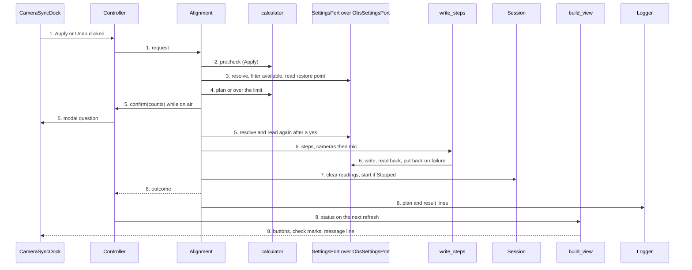
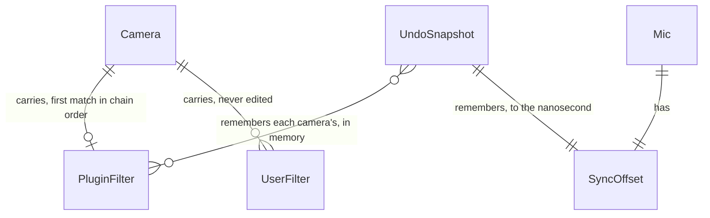
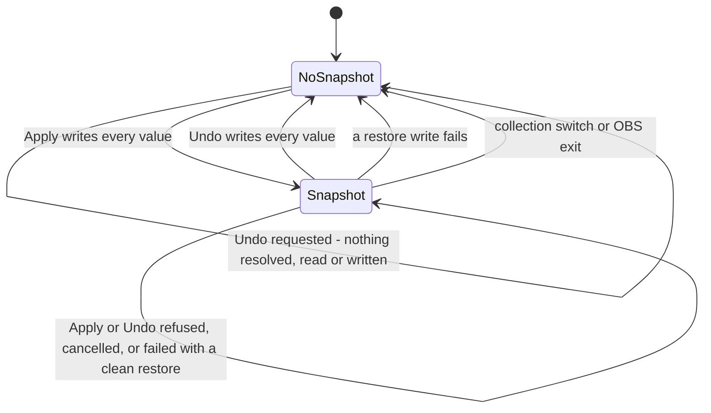

# Alignment

**Approved**: 2026-10-28 - user: "approved, keep going"

## Problem

Reading gives every ticked camera a stable reading against the mic, and nothing acts on it. The
user works out each camera's delay and the mic's Sync Offset by hand, types them into OBS's
dialogs, and gets them wrong in the ways the forum threads the design cites show: Render Delay put
on cameras instead of Video Delay (Async), a negative offset where a delay was needed, one camera
fixed and the others left out. A half-done correction is worse than none: the cameras then
disagree with each other on air. The evidence is those threads and the OBS Offset Calculator's
1,798 downloads in 13 months (`.design/multi-camera-sync.md`, Problem); how long the manual loop
takes is unmeasured.

When this ships, one Apply writes every correction where OBS keeps it, or writes nothing, one Undo
takes it back, and after one measure-and-apply pass every ticked camera reads within one frame of
the mic.

## Shape

Reuses Reading's session, readings and frame interval, `camera_list`'s checklist order, the
injected `Logger` and `quote`, `round_half_away`, and the view-model's message line, and corrects
through OBS's own Video Delay (Async) filter and Sync Offset instead of anything of the plugin's
own. Every rule that changes an outcome - the precheck, the arithmetic, the limit, which values are
written and in what order, the restore, the Undo snapshot's lifetime, the message text and its
precedence, the question's wording - runs in the OBS-free core (`core/`), which the doctest suite
reaches on WSL and in CI; `src/` only forwards.

1. the user clicks Apply or Undo in `CameraSyncDock` (exists) -> `Controller` (exists) - builds the
   request: the ticked cameras in `camera_list` order with their names, the mic, the `Session`
   snapshot (readings, state, F), the canvas frame rate
2. `Alignment` (new) - Apply's precheck over the readings: "waiting" and "already aligned" end
   here, with nothing resolved or read; Undo with no snapshot ends here
3. `SettingsPort` (new) over `ObsSettingsPort` (new) - resolves every source, checks Video Delay
   (Async) is registered, reads each camera's plugin filter and the mic's Sync Offset: the restore
   point
4. `calculator` (new) - Δ and every new value, or the first source over 20,000 ms; for Undo the
   targets are the snapshot's values
5. `Alignment` (new) - while on air, asks through `Controller` (exists) and the dock's modal
   question; after a yes, resolves and reads again and refuses on any difference from step 3 or a
   collection switch
6. `write_steps` (new) - writes the changed values through `SettingsPort`, cameras then mic, reads
   each back; on a failure puts back every value it changed, in reverse order; persists the plugin
   filter (door 1) and the mic's Sync Offset in the scene collection
7. `Session` (exists) - every reading cleared, the pattern kept; after an Apply that succeeds, a
   Stopped session starts at the canvas rate
8. out: the outcome and the in-memory Undo snapshot held by `Alignment`; `build_view` (exists)
   reads them on the next refresh for the buttons, the check marks and the message line that
   `CameraSyncDock` (exists) draws; the plan and the result go to the OBS log through `Logger`
   (exists)

**Changes underneath**

| Front | What changes |
| --- | --- |
| domain | new term: plugin filter - the first Video Delay (Async) filter on a camera, in chain order, whose name is on the recognised-names list; every other filter is the user's. Reading measures through both and branches on neither |
| domain | new term: Undo snapshot - the values Apply read before writing, held in memory until Undo, a later Apply, a collection switch or exit |
| domain | `Session::on_mic_sync_offset_changed` clears every reading and keeps the pattern; that body becomes `clear_readings()`, which Apply and Undo also call. READ-59's test branches on it and must pass unchanged |
| domain | `SessionSnapshot` gains F, the frame interval read at the last Start, 0 before any Start; the view-model's check marks read it |
| stored data | nothing to migrate: the plugin stores nothing of its own beyond Reading's selection; it writes OBS's own filter and Sync Offset, which OBS saves in the scene collection |
| readers | the dock's buttons, rows and message line (criteria 47 to 64); the ~60 Reading view-model tests call `build_view`, whose new parameter is defaulted so they stay as they are |
| readers | Reading's `filter_add`, `filter_remove` and `audio_sync` handlers see Apply's own writes and clear the readings a second time, a few ms after Apply did - harmless, noted so nobody files it |
| readers | OBS without the plugin loads the plugin filter and the offset from the collection and keeps applying them (criterion 68) |

New: `PluginFilter` on a camera, persisted by OBS in the scene collection, and `UndoSnapshot`, in
memory only. One-way constraints: the plugin filter's type `async_delay_filter`, name `Camera Sync
Delay` and setting `delay_ms` (door 1).

## Surface

None - nothing consumed outside: the plugin exposes no route or API. What it leaves in OBS is the
plugin filter and the mic's Sync Offset, fixed by door 1.

## Landing

| One-way door | Literal shape | Alternative rejected |
| --- | --- | --- |
| 1. The plugin filter in users' scene collections (ADR-001, ADR-004) | OBS filter type `async_delay_filter` (Video Delay (Async)), named `Camera Sync Delay`, setting `delay_ms` as a whole number from 0 to 20,000, appended at the end of the camera's filter chain, enabled. Found again as the first filter in chain order with that type and a name on `recognised_filter_names = {"Camera Sync Delay"}`; a later rename adds a name to the list and never removes one. The mic's Sync Offset is written as `s′ × 1,000,000` ns | a filter type of the plugin's own - it would vanish from the collection when the plugin is removed (Key decision 1); `obs_source_get_filter_by_name` - it returns the last filter of that name of any type, so it would edit a user's filter (ADR-004) |
| 2. Integration tests against a real libobs in CI | a Linux-only doctest executable `camera-sync-integration-tests` in `tests/integration/`, built only in the Ubuntu plugin build, that compiles `.deps/obs-studio-30.0.2/plugins/obs-filters/async-delay-filter.c` into the test, starts libobs on first use, and runs in the Ubuntu job as `xvfb-run -a ctest ...` with `xvfb` installed there | loading obs-filters as a module - it needs every plugin's dependencies on the Ubuntu job; fake-port tests alone - they cannot show that libobs keeps the filter and the offset as written |

- Nothing else in this change is hard to reverse: the settings port, the calculator and the
  locale keys are internal and change with a refactor before the first release

## Criteria

Criterion n is the spec's ALIGN-n, worded as the maintainer approved it on 2026-10-20. The
examples under each come from the approved tasks' "Done when" lists; where one is new it is the
strong case the criterion's own words already decide. F is the frame interval the session read at
its last Start; a reading r is within one frame when −F ≤ r ≤ F. Checklist order is alphabetical by
source name, ignoring case.

### S1: The calculator turns readings into an alignment (P1)

Readings and the current values go in; a delay for each camera and a Sync Offset for the mic, or a
refusal, come out. Pure: the same inputs always give the same output.

**Acceptance Criteria**

1. IF any ticked camera is not Stable THEN the calculator SHALL refuse with "waiting" and name the first such camera in checklist order
   - Stable, Settling, Stable → waiting, the second camera; Looking, Settling → waiting, the first; a Settling camera whose reading is within ±F → waiting, never "already aligned"
2. WHEN every ticked camera is Stable and every reading r satisfies −F ≤ r ≤ F THEN the calculator SHALL return "already aligned" and no plan
   - F 33.333: (+20, −30) → already aligned; (+33, −33) → already aligned; (+34, 0) → a plan; (0, −34) → a plan; F 33.0: +33 → already aligned, +34 → a plan
3. The calculator SHALL take each camera's current delay dᵢ as its effective delay: the plugin filter's delay when the filter is present and enabled, and 0 when it is absent or disabled
   - no filter → 0; enabled at 60 → 60; disabled at 60 → 0, so r (+100, +40) with it on the first camera gives d′ (0, 60) and the first camera unchanged, where the same filter enabled gives Δ 40
4. The calculator SHALL set Δ to the largest of every (rᵢ − dᵢ) and −s, where s is the mic's Sync Offset in ms rounded half away from zero from its nanoseconds
   - −200,400,000 ns → s −200; −200,500,000 ns → s −201; −200,600,000 ns → s −201
5. The calculator SHALL give each ticked camera the new delay dᵢ′ = dᵢ + Δ − rᵢ and the mic the new Sync Offset s′ = s + Δ
   - one camera at +75 with s 0 → Δ 75, d′ 0, s′ 75
6. The calculator SHALL produce no negative new delay and no negative new Sync Offset
   - every vector of criterion 8, and every point of a grid of readings from −1,000 to +1,000 ms in steps of 37 with d in {0, 200} and s in {−950, 0, 300} → no new value below 0
7. IF any new delay or the new Sync Offset is above 20,000 ms THEN the calculator SHALL refuse with "over the limit" and name the first such source, the cameras in checklist order and then the mic; a value of exactly 20,000 ms SHALL be accepted
   - a camera at 20,000 → accepted; a camera at 20,001 → refused naming it; the mic at 20,000 → accepted; the mic at 20,001 → refused naming the mic; two cameras over → the first is named
8. WHEN the inputs are any of the TDD's eight test vectors at F = 33 ms THEN the calculator SHALL return exactly that row's Δ and new values, or "already aligned" for the last row
   - r (+100, +40), d (0, 0), s 0 → Δ 100, d′ (0, 60), s′ 100
   - r (−50, −120), d (0, 0), s 0 → Δ 0, d′ (50, 120), s′ 0
   - r (+40, +40), d (0, 60), s 100 → Δ 40, d′ (0, 60), s′ 140
   - r (+150, +30), d (200, 0), s 100 → Δ 30, d′ (80, 0), s′ 130
   - r (−50, −30), d (0, 0), s 100 → Δ −30, d′ (20, 0), s′ 70
   - r (+480, +30), d (0, 0), s 0 → Δ 480, d′ (0, 450), s′ 480
   - r (+60, +10), d (0, 0), s −200 → Δ 200, d′ (140, 190), s′ 0
   - r (+20, −30) → already aligned, nothing written
9. The calculator SHALL mark a camera as changed when its new delay differs from its effective delay, and the mic as changed when s′ differs from s
   - the first vector → the first camera unchanged, the second camera and the mic changed; the second vector → the mic unchanged
10. WHEN a camera has no plugin filter and its new delay is 0 THEN the plan SHALL not create a filter for it
    - the first vector's first camera, with no filter and d′ 0 → no step for it

### S2: Apply writes the alignment all or nothing (P1)

One Apply writes every correction into OBS or none, and keeps what it found for Undo.

**Acceptance Criteria**

11. IF Apply is requested with no mic chosen, no camera ticked, or a ticked camera that is not Stable THEN Apply SHALL resolve, read and write nothing
    - no mic → no port call; no camera → no port call; a Settling camera → no port call, "waiting" naming it, and "waiting" not kept as the last result
12. WHEN Apply is requested and the calculator returns "already aligned" THEN Apply SHALL resolve, read and write nothing, and report "already aligned"
    - (+20, −30) at F 33 → no port call, "already aligned"; the same with the mic's offset hand-set to −200 ms → still no port call, and the offset stays −200 ms
13. IF a ticked camera or the mic does not resolve by its UUID THEN Apply SHALL write nothing and report "failed"
    - a ticked camera gone → no write, "failed"; the mic gone → no write, "failed"
14. IF Video Delay (Async) is not available in OBS THEN Apply SHALL write nothing and report "failed"
    - a plan that creates a filter → no write, "failed"; a plan that only changes an existing plugin filter → no write, "failed"
15. WHEN every source resolves THEN Apply SHALL read each ticked camera's plugin filter (absent, or present with its delay and enabled state) and the mic's Sync Offset in nanoseconds, compute the plan from them, and keep them as the restore point
    - two cameras and the mic → each read once, in request order, every read before the first write
16. IF the calculator refuses with "over the limit" THEN Apply SHALL write nothing and report "over the limit" with the named source
    - a plan giving the second camera 20,001 ms → no write, "over the limit" naming that camera
17. WHILE streaming or recording is active, WHEN the plan is ready THEN Apply SHALL ask for confirmation with the plan's counts before writing anything
    - off air → never asked; on air with the first vector → asked once, after the reads and before any write, with 1 camera and the mic; the second vector → 2 cameras and no mic
18. IF the confirmation is cancelled THEN Apply SHALL write nothing and report "cancelled"
    - cancel → no write; the last result and the Undo snapshot stay as they were
19. WHEN the confirmation is accepted THEN Apply SHALL resolve and read every value again, and IF a source is gone or any value differs from the first read THEN it SHALL write nothing and report "failed"
    - a camera's delay changed while asking → no write; the mic's offset changed → no write; a source gone → no write; the collection switched while asking with every source still resolving to the same values → no write; a reading changed while asking with OBS's values unchanged → the plan the user saw is written
20. WHEN Apply writes THEN it SHALL write only the values the plan marks as changed, the ticked cameras first in checklist order and then the mic
    - the first vector → the second camera's filter, then the mic; the first camera not written
21. WHEN a changed camera has no plugin filter THEN Apply SHALL create a Video Delay (Async) filter named "Camera Sync Delay" at the end of that camera's filter list, enabled, with the new delay
    - the first vector → the second camera gets "Camera Sync Delay", 60 ms, enabled, last in its chain
22. WHEN a changed camera has a plugin filter THEN Apply SHALL set its delay to the new delay, including 0, and enable it, and SHALL not remove it
    - enabled at 200, new 80 → 80 and enabled; enabled at 200, new 0 → 0, enabled and kept; disabled at 60, new 60 → 60 and enabled
23. WHEN the mic is changed THEN Apply SHALL set its Sync Offset to s′ × 1,000,000 ns
    - the first vector → 100,000,000 ns
24. Apply SHALL read back each value right after writing it, and SHALL treat a write as failed when the port reports a failure or the value read back differs from the value written
    - three steps that land → write, read, write, read, write, read; a write the port refuses → failed; a write the port accepts whose read-back differs → failed
25. IF a write fails THEN Apply SHALL write nothing more from the plan, put back every value it changed from the restore point in reverse order of writing, remove every filter it created, and report "failed"
    - a failure at each of three write positions and at each of three read-backs → every value as it was and no created filter left; a created filter whose delay reads back wrong → removed
26. IF a write made while putting values back fails THEN Apply SHALL still put back the remaining values, report "restore failed", and drop the Undo snapshot
    - one restore write fails → every other value put back, "restore failed", no Undo snapshot
27. WHEN every write lands THEN Apply SHALL keep the restore point as the Undo snapshot, replacing any earlier one, and report "applied" with the plan
    - the first vector → the snapshot holds each ticked camera's filter as found and the mic's nanoseconds exactly; the report lists each ticked camera's new delay in order, then the mic's new offset; a second Apply replaces the snapshot
28. WHEN every write lands THEN Apply SHALL clear every reading, keep the pattern, and leave the session Measuring, starting it with the current canvas frame rate if it was Stopped
    - Measuring → readings cleared and no start; Stopped → readings cleared, then started at the request's rate
29. IF Apply fails after writing at least one value THEN it SHALL clear every reading and keep the pattern and the session's state; a refusal or failure before the first write SHALL leave every reading as it was
    - a failure at the second write → readings cleared, no start; a source gone before any write → readings untouched
30. IF Apply reports "failed" THEN the Undo snapshot of an earlier Apply SHALL stay as it was
    - Apply, then an Apply that fails with a clean restore → the first snapshot and the aligned flag stay

### S3: Undo puts back what was there (P1)

One Undo puts back exactly the values from before the last Apply, all or nothing.

**Acceptance Criteria**

31. IF Undo is requested with no Undo snapshot THEN Undo SHALL resolve, read and write nothing
    - before any Apply → no port call; Apply, Undo, Undo → the second Undo makes no port call
32. The Undo snapshot SHALL live in memory only, and SHALL be dropped when the scene collection changes, when OBS exits, when a later Apply replaces it, and when Undo succeeds
    - Apply then a collection switch → no snapshot; Apply, Apply, Undo → the values from before the second Apply; Apply then Reset → the snapshot kept
33. IF a source in the snapshot does not resolve, or Video Delay (Async) is not available, THEN Undo SHALL write nothing, report "failed" and keep the snapshot
    - a snapshot camera gone → no write, snapshot kept; filter type unavailable → no write, snapshot kept
34. WHEN every source in the snapshot resolves THEN Undo SHALL read each snapshot camera's plugin filter and the mic's Sync Offset as its restore point
    - two cameras and the mic → each read once before the first write
35. WHILE streaming or recording is active, WHEN Undo is ready to write THEN it SHALL ask for confirmation with the counts of the values it would change; a cancel SHALL write nothing and keep the snapshot
    - on air, an Apply that changed one camera and the mic → asked with 1 camera and the mic; cancel → no write, snapshot kept
36. WHEN Undo writes THEN, for each camera in the snapshot in checklist order, it SHALL remove the plugin filter if Apply created it and it is still there, or set the filter's delay and enabled state to the snapshot's, creating the filter at the end of the camera's filter list if it is gone; and then it SHALL set the mic's Sync Offset to the snapshot's nanoseconds exactly
    - s −200,000,000 ns applied then undone → exactly −200,000,000 ns; a filter Apply created → removed; a filter at 120 ms disabled before Apply and deleted by hand after → created again at 120 ms disabled; a filter Apply created and the user deleted or renamed → no step
37. WHEN Undo writes THEN it SHALL write only the values that differ from its restore point, and SHALL write the snapshot's values even where they were changed by hand after Apply
    - an Apply that changed one camera and the mic → an Undo of two steps; that camera's delay set by hand after Apply → written back to the snapshot's
38. Undo SHALL read back each value right after writing it, and IF a write fails THEN it SHALL put back every value it changed from its restore point in reverse order, remove any filter it created, report "failed" and keep the snapshot
    - a failure at each Undo write position → the values from after Apply, snapshot kept
39. IF a write made while putting values back fails THEN Undo SHALL still put back the remaining values, report "restore failed" and drop the snapshot
    - one restore write fails → every other value put back, "restore failed", no snapshot
40. WHEN every write lands THEN Undo SHALL drop the snapshot, clear every reading, keep the pattern and the session's state, and report "undone" with the restored values
    - Measuring → still Measuring, readings cleared; Stopped → still Stopped, no start; the report lists each snapshot camera's restored delay in Apply's order, 0 for a removed filter, then the mic's offset rounded half away from zero to whole ms

### S4: The settings port touches only the plugin's filter and the mic's Sync Offset (P1)

Key decision 4, made structural: the port has no operation that reaches anything else.

**Acceptance Criteria**

41. The settings port SHALL offer only these operations: resolve a source by UUID; read a camera's plugin filter; write a camera's plugin filter's delay and enabled state, creating the filter if it is absent; remove a camera's plugin filter; read the mic's Sync Offset; write the mic's Sync Offset; say whether streaming or recording is active; say whether Video Delay (Async) is available
    - a UUID nobody has → does not resolve, reads return nothing, writes return failure
42. The port SHALL take as a camera's plugin filter the first filter on it, in filter order, whose type is Video Delay (Async) (`async_delay_filter`) and whose name is on the recognised-names list, which holds "Camera Sync Delay"
    - two plugin filters → the first in chain order is read and written; only a filter of another type named "Camera Sync Delay" → no plugin filter, and a write creates one after it
43. The port SHALL never edit, reorder or remove a filter that is not the camera's plugin filter, including a filter with a recognised name and another type, and a Video Delay (Async) filter with another name
    - a camera carrying, in order, a Video Delay (Async) named "Delay", a filter of another type named "Camera Sync Delay" and a Render Delay → after a write and a remove all three are unchanged in settings, enabled state and order, and the plugin filter was created after them
44. The port SHALL write the plugin filter's delay as its `delay_ms` setting in whole milliseconds from 0 to 20,000, and the mic's Sync Offset in nanoseconds
    - `delay_ms` 0 and 20,000 written and read back; −200,000,000 ns written and read back to the nanosecond
45. The port SHALL report on air WHILE streaming is active or recording is active, including a paused recording, and SHALL not report on air for the virtual camera or the replay buffer alone
    - streaming → on air; recording paused → on air; virtual camera alone → off air; replay buffer alone → off air
46. The port SHALL never add or edit Render Delay, and SHALL never change a scene, an audio track, any property of the mic other than its Sync Offset, or any source other than the ticked cameras' plugin filters and the mic
    - the scene collection saved before and after Apply differs only in the plugin filters and the mic's sync offset (criterion 66)

### S5: The dock offers Apply and Undo and says what happened (P1)

The design's "Dock shows" column for every Alignment row; the rules sit in the view-model.

**Acceptance Criteria**

47. WHILE a mic is chosen, at least one camera is ticked and every ticked camera is Stable, the view-model SHALL enable Apply
    - two ticked cameras Stable → enabled; either Settling → disabled; no mic → disabled; no camera ticked → disabled
48. WHILE a mic is chosen and a ticked camera is not Stable, the view-model SHALL disable Apply and, when no message of higher precedence applies, show "Waiting for {camera}" on the message line with the first such camera's name in checklist order
    - "Brio" Stable, "cam b" Settling, "Cam C" Looking → "Waiting for cam b"; the same while "No pattern sound from {mic} - ..." applies → that message instead
49. The view-model SHALL enable Undo while an Undo snapshot exists and disable it otherwise
    - snapshot → enabled; none → disabled
50. WHEN Apply reports "already aligned" THEN the message line SHALL read "Already aligned"
51. WHEN Apply reports "over the limit" THEN the message line SHALL read "{camera} needs more delay than OBS allows" with the named source's name, which is the mic's name when the mic is the source
    - Cam B → "Cam B needs more delay than OBS allows"; the mic Shure MV7 → "Shure MV7 needs more delay than OBS allows"
52. WHEN Apply reports "failed" THEN the message line SHALL read "Apply failed - nothing changed"
53. WHEN Apply reports "restore failed" THEN the message line SHALL read "Apply failed - check the log"
54. WHEN Apply reports "applied" THEN the message line SHALL read "Applied - " followed by each ticked camera's new delay in checklist order and then the mic's new Sync Offset, each as "{name} {value} ms", separated by ", "
    - Cam A 0, Cam B 60, Shure MV7 100 → "Applied - Cam A 0 ms, Cam B 60 ms, Shure MV7 100 ms"
55. WHEN Undo reports "undone" THEN the message line SHALL read "Undone - " followed by each snapshot camera's restored delay in checklist order, 0 for a removed filter, and then the mic's restored Sync Offset rounded half away from zero to whole ms, in the same form; a negative value SHALL carry a leading "−" (U+2212) and a non-negative one no sign
    - Cam A 0, Cam B 0, Shure MV7 −200 → "Undone - Cam A 0 ms, Cam B 0 ms, Shure MV7 −200 ms"; values 60, 0, −200 → "60", "0", "−200"
56. WHEN Undo reports "failed" THEN the message line SHALL read "Undo failed - nothing changed", and WHEN it reports "restore failed" THEN "Undo failed - check the log"
57. The view-model SHALL keep the last Apply or Undo message until the next Apply or Undo request, Reset or collection switch, and a cancelled question SHALL leave the previous message as it was
    - after "already aligned", "over the limit", "failed", "applied" or "undone" → that message; after "cancelled" or "waiting" → the message before; after Reset or a collection switch → none
58. WHILE the last successful Apply has not been followed by an Undo, a Reset, a collection switch or a failed restore, a ticked camera that is Stable with −F ≤ reading ≤ F SHALL show its status prefixed with "✓ " (U+2713 and a space)
    - F 33.333 after an Apply: Stable +4 → "✓ +4 ms - video late"; Stable 0 → "✓ 0 ms - in sync"; Stable +34 → no mark; Settling → no mark; with no Apply, every camera within ±F → no mark
59. WHILE every ticked camera shows the check mark, the message line SHALL read "Aligned"
    - every ticked camera marked → "Aligned"; one unmarked → the last result, or "Waiting for ..."
60. The message line SHALL show the highest of: "Pick at least one camera and the mic", "Could not listen to {mic}", "No pattern sound from {mic} - ...", "Aligned", the last Apply or Undo message, "Waiting for {camera}"
    - each adjacent pair shown together → the higher one; "Aligned" over "Applied - ..."
61. The on-air question SHALL count {n} as the cameras whose value changes, and SHALL read "Shift {n} cameras and the mic while on air?" for n ≥ 2 with the mic changed, "Shift 1 camera and the mic while on air?" for one camera with the mic changed, "Shift {n} cameras while on air?" for n ≥ 2 with the mic unchanged, "Shift 1 camera while on air?" for one camera with the mic unchanged, and "Shift the mic while on air?" for no camera with the mic changed
    - 3 and the mic → "Shift 3 cameras and the mic while on air?"; 1 and the mic → "Shift 1 camera and the mic while on air?"; 2 → "Shift 2 cameras while on air?"; 1 → "Shift 1 camera while on air?"; the mic alone → "Shift the mic while on air?"
62. WHEN n is 1 or more THEN the on-air question SHALL add a second line, "Cameras whose delay changes pause until their new delay fills."
    - 1 camera → the line; the mic alone → no second line
63. The view-model SHALL resolve every string this slice adds through a key in the en-US locale file, and every key it uses SHALL exist there (extends READ-48)
64. The dock SHALL show an Apply button and an Undo button, labelled "Apply" and "Undo", next to Start/Stop and Reset, forward their clicks, and show the on-air question as a modal dialog with "Apply" and "Cancel" buttons
    - a click on Apply runs Apply and the message line shows its result; a click on Undo runs Undo; while recording, Apply opens the question, and "Cancel" writes nothing

### S6: The rig confirms the alignment (P1)

Apply and Undo run on the real rig in the oldest and newest supported OBS.

**Acceptance Criteria**

65. WHEN two cameras with clearly different lags, one carrying a Render Delay, and the mic are measured to Stable on the rig and Apply is pressed THEN every camera SHALL re-measure within one frame of the mic, in each of three runs in a row, in OBS 30.0.0 and in the latest stable OBS
66. WHEN the scene collection is saved before and after Apply THEN the two files SHALL differ only in each changed camera's plugin filter (added, or its `delay_ms` and enabled state) and the mic's sync offset
67. WHEN Undo is pressed after Apply THEN the scene collection saved afterwards SHALL equal the one saved before Apply
68. WHEN the plugin is removed after an Apply and OBS is restarted THEN the scene collection SHALL load with every plugin filter and the mic's Sync Offset in place and working
69. WHEN every row of the design's Alignment table except "a write fails partway" is walked on the rig through interactive UAT THEN the dock SHALL show the text this plan gives for it, including the on-air question while recording

### S7: Apply and Undo are visible in the OBS log (P2)

Every plan, result and refusal in the log, so a user's log shows what Apply wrote and how to put
it back by hand.

**Acceptance Criteria**

70. WHEN Apply is about to write THEN it SHALL log at Info `apply.plan`, then for each ticked camera `camera="<name>" delay_ms=<old>-><new>`, with `none` as the old value for an absent filter and `<value>(off)` for a disabled one, then `mic="<name>" sync_offset_ms=<old>-><new>`
    - Cam A with no filter, Cam B disabled at 60, mic Shure MV7, the first vector → `apply.plan camera="Cam A" delay_ms=none->0 camera="Cam B" delay_ms=60(off)->60 mic="Shure MV7" sync_offset_ms=0->100`
71. WHEN every write lands THEN Apply SHALL log at Info `apply.result ok written=<n> skipped=<m> duration_ms=<d>`, where n counts the values written, m the values left unchanged, and d the whole milliseconds from the request (after any question) to the result
    - the first vector → `apply.result ok written=2 skipped=1 duration_ms=<d>`; 3 s inside the question and 4 ms of writes → `duration_ms=4`
72. WHEN a write fails THEN Apply SHALL log at Warning `apply.result failed step=camera:"<name>"` or `step=mic:"<name>"` for the failed write, followed by `restored=yes` or `restored=no`
    - `apply.result failed step=camera:"Cam B" restored=yes`; `apply.result failed step=mic:"Shure MV7" restored=no`
73. WHEN a write made while putting values back fails THEN Apply SHALL log at Warning `restore.failed camera="<name>" intended_ms=<value> actual_ms=<value>` or `restore.failed mic="<name>" intended_ns=<value> actual_ns=<value>`, with `none` for an absent filter
    - `restore.failed camera="Cam B" intended_ms=0 actual_ms=60`; `intended_ms=none` for a filter that should be gone; `restore.failed mic="Shure MV7" intended_ns=-50000000 actual_ns=0`
74. WHEN Apply refuses THEN it SHALL log at Warning `apply.refused reason=waiting camera="<name>"`, `reason=source_gone source="<uuid>"`, `reason=no_delay_filter`, `reason=over_limit source="<name>" value_ms=<value>` or `reason=changed`, and SHALL log at Info `apply.already_aligned` and `apply.cancelled`
    - `apply.refused reason=over_limit source="Cam B" value_ms=20001`
75. WHEN Undo plans, writes, refuses or fails THEN it SHALL log the same lines with the prefix `undo.` in place of `apply.`, its plan's new values being the snapshot's, and `undo.result ok ...` on success
76. The log lines SHALL write every source name with each `"` as `\"`, as Reading's lines do (READ-88)
    - a camera named `Cam "B"` → `camera="Cam \"B\""` in every line that names it

### S8: Apply and Undo run against real OBS objects in CI (P2)

The fake port proves the logic; only libobs proves the filter and Sync Offset calls.

**Acceptance Criteria**

77. The Ubuntu CI job SHALL start libobs headless with OBS 30.0.2's Video Delay (Async) registered, compiled from `plugins/obs-filters/async-delay-filter.c` of the OBS sources the build downloads, and run Apply and Undo against a test async source and a test audio source: create, find, update and remove the plugin filter; read and write the Sync Offset; check each against the value set
    - the first vector on two test cameras and a test mic → the second camera gets a plugin filter at 60 ms, the mic 100,000,000 ns, the first camera no filter; Undo → all three as they started
78. WHEN the test source is removed between the reads and the writes of an Apply THEN the integration test SHALL see every value on the remaining sources restored and no plugin filter left that Apply created
79. The integration test SHALL check that a user's own Video Delay (Async) filter, a filter of another type with a recognised name, and a Render Delay on the test source are unchanged and in the same order after Apply and after Undo
80. IF libobs cannot start headless on CI THEN the same checks SHALL run on the rig and be recorded in `validation.md`

### S9: Apply is quick (P2)

**Acceptance Criteria**

81. WHEN Apply writes a plan for four cameras and the mic on the rig THEN the `duration_ms` of its `apply.result` line SHALL be under 100

## Out of scope

| Excluded | Why |
| --- | --- |
| Showing each camera's current delay and the mic's Sync Offset on the rows at all times | offered during discussion and not chosen; the message line shows the result of each Apply and Undo (`context.md`) |
| Undo of more than the last Apply, Undo after an OBS restart, Redo | design Alignment default 1 |
| Adjusting cameras that are not ticked | Apply writes only the ticked cameras and the mic |
| Removing the plugin's filter when its delay falls to 0 | the TDD sets it to 0 and keeps it; only Undo, or a failed Apply's restore, removes a filter Apply created |
| Shrinking a user's own filter, or adding or editing Render Delay | Key decisions 2 and 4 |
| Noticing a hand edit of a filter's delay or enabled state while readings are kept | Reading observes only filter add and remove and Sync Offset changes; Apply clears the readings it makes stale itself |
| The final product name, and so the final filter name | Release (TDD Open question 14); the recognised-names list absorbs a rename |
| Pattern files, packaging, the forum page | Release phase |
| The spikes, and Reading's rig tasks T34 to T37 | Reading's |
| Locales other than en-US | as in Reading |
| Drift, more than one mic, measuring without the pattern, screen, window and game captures, a camera's own mic as the reference | design Boundary |

## Assumptions

Rows the spec marked as the agent's defaults stayed open until the spec was confirmed; the
maintainer approved the spec with them on 2026-10-20, so they carry `y` here.

| Assumption | Chosen default | Rationale | Confirmed? |
| --- | --- | --- | --- |
| How alignment is built | tlc-spec-lean: this plan and `checks.md` replace the 23 tasks of `tasks.md`; the spec, design and context stay the approved sources | maintainer's choice on 2026-10-28: "Build alignment (lean)" | y |
| What the dock shows after Apply and Undo | one summary on the message line built from the plan or the snapshot | discussed (`context.md`, Showing the result) | y |
| "Already aligned" and "Aligned" | "Already aligned" answers an Apply pressed with every reading within one frame; "Aligned", with a check mark on each row, appears after a successful Apply once every ticked camera is stable again within one frame | discussed (`context.md`) | y |
| When the on-air question is asked and what it counts | after the reads and the plan; {n} counts the cameras whose delay changes; the mic is named only when its offset changes | discussed (`context.md`); no write happens before the answer | y |
| The question's second sentence | "Cameras whose delay changes pause until their new delay fills.", shown when at least one camera changes | accepted in the discussion's preview; TDD finding 7 | y |
| What Undo does to measuring | clears every reading, keeps the pattern, leaves the session's state as it was | discussed (`context.md`) | y |
| The frame tolerance F | the frame interval the session read at its last Start, `1000 × fps_den ÷ fps_num` ms | the TDD's arithmetic step 2; the F Reading uses for stability | y |
| Checklist order | alphabetical by source name, ignoring case, as the camera checklist is (READ-49) | the order the user sees | y |
| The Sync Offset in the arithmetic | s rounded half away from zero from ns; Apply writes whole ms; Undo restores the ns read before Apply exactly; an unchanged offset is not written | OBS's dialog sets whole ms; the TDD asks Undo to restore to the nanosecond | y |
| A disabled plugin filter | effective delay 0; a non-zero plan enables it; Undo puts back the delay and the disabled state | the filter is the plugin's own (Key decision 4) | y |
| What a change during the on-air question does | after a yes Apply resolves and reads again; any difference or a gone source writes nothing | Key decision 3 forbids writing a plan computed from values since changed | y |
| Which readings Apply uses | the readings when Apply is pressed | the question is about the plan the user saw | y |
| Readings after a failed Apply | cleared if anything was written, the session's state kept; untouched if nothing was | the result is the same whichever write failed | y |
| The pattern after Apply or Undo | kept; only the readings are cleared | Reset is how the user drops the pattern (READ-27) | y |
| The Undo snapshot after a failed Apply | kept after a clean restore; dropped after a failed restore | after a clean restore the setup is the one the snapshot was taken from | y |
| Undo while on air | asks first, with Apply's wording rules | Undo pauses cameras the same way (TDD finding 7) | y |
| Undo after a hand edit since Apply | a created filter the user deleted is no failure; one the user renamed is the user's and left alone; a pre-existing filter deleted since is created again with its snapshot values | ADR-008: Undo restores the earlier values exactly | y |
| A refused Undo | keeps the snapshot so Undo can be tried again | a source may come back after a scene change | y |
| Cameras that are not ticked | neither read nor written, even when the mic's offset changes | Apply aligns the cameras the user ticked | y |
| The question for one camera and for the mic alone | separate en-US strings for each wording | OBS's locale files have no plural rules | y |
| How long an Apply or Undo message stays | until the next Apply or Undo request, Reset or collection switch, below the messages that outrank it | the result stays readable while measuring resumes | y |
| The message line's precedence | the order of criterion 60 | a problem the user must fix outranks a result | y |
| Check marks before every row has one | each row gets its mark once that camera is stable within one frame; "Aligned" once every row has one | shows progress | y |
| On air | streaming, or recording including paused; the virtual camera and the replay buffer alone are not | the design names streaming and recording | y |
| Failed restore and failed Undo text | "Apply failed - check the log", "Undo failed - nothing changed", "Undo failed - check the log" | the TDD's proposals | y |
| A plugin filter for a new delay of 0 | not created; an existing one is set to 0 and kept | TDD default | y |
| Video Delay (Async) not available | Apply and Undo refuse before any write | an existing filter of an unloaded type delays nothing | y |
| Integration tests | headless libobs on Linux CI with OBS 30.0.2's own filter compiled in; the rig if libobs cannot start (criterion 80) | the TDD's Testing Strategy; the maintainer's design choice | y |
| Where each proof runs | the core's rules in the `core` preset on WSL and in CI; the OBS port, the integration tests, the controller and the dock in CI's three builds; slice S6 and criterion 81 on the rig, walked by the maintainer | WSL has no OBS build and no `gh`, so CI results are read from the run and the rig is the maintainer's | y |

**Open questions:**

- May the build push to `origin/main` when a slice that touches `src/`, `tests/integration/` or CI
  is ready, so CI runs its proofs? Every earlier feature landed on `main` directly. - open; asked
  with this plan, and until answered the build stops at local commits

## Differences from the source

None - the product matches the source

## Sources

- `.specs/features/alignment/spec.md` - binding - criteria 1 to 81 (ALIGN-01 to ALIGN-81), out of
  scope and assumptions, approved 2026-10-20
- `.specs/features/alignment/context.md` - binding - the four gray-area decisions of 2026-10-20
- `.specs/features/alignment/design.md` - binding for the maintainer's two choices in it (Apply and
  Undo each one call with the question as a callback; the integration test compiles OBS's own
  filter); the rest is the approved component design the build follows unless `## Handoff` records
  why it departs
- `.specs/features/alignment/tasks.md` - superseded by this plan on 2026-10-28; its "Done when"
  examples are carried into the criteria
- `.design/multi-camera-sync.md` - binding - the Alignment slice's state table and Boundary
- `docs/tdd/multi-camera-sync.md` - binding - the arithmetic, the eight test vectors, Apply's steps
- `docs/adr/` ADR-001 to ADR-004 and ADR-008 - binding - where the alignment lives, delays only,
  the remainder, the plugin's own filter, all or nothing and undoable
