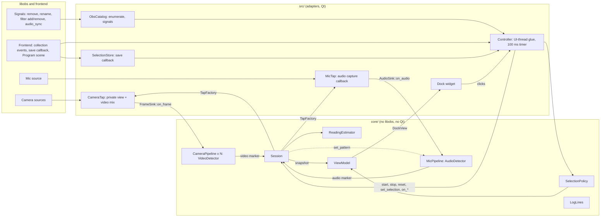

# Reading Design

**Spec**: `.specs/features/reading/spec.md`
**Status**: Draft

> How to build Reading (READ-01 to READ-98). The TDD's architecture (OBS adapters, an OBS-free core, a thin dock) is binding; this document fixes the classes, files, contracts and threads inside it. `.specs/STATE.md` does not exist yet, so there are no active `AD-NNN` decisions to conform to; the ADRs in `docs/adr/` are the decision log. No confirmed lessons exist.
>
> Everything marked **(spike)** depends on a libobs behaviour that no one has run: there are no OBS headers or network on the WSL machine, so the API names come from the TDD and from memory of OBS 30. Spike 1 confirms them on the rig, and story 9 re-checks them.

---

## Architecture Overview

Rules live in the core, behind four ports (a tap factory, a clock, a logger, and plain structs for what the catalog sees). The plugin's `src/` implements the ports with libobs and Qt and holds no rule. A `Controller` in `src/` is the only object that knows both sides.



Three rules keep it testable:

1. **The core never reads a clock, an OBS object or a file.** Time comes from an injected `Clock`, taps from an injected `TapFactory`, strings from an injected `Translate`. The unit tests inject fakes and drive time by hand.
2. **The session is the only object that changes measuring state,** and it does so on the UI thread. Tap threads only push frames, audio and markers into thread-safe entry points.
3. **Every entry point from OBS is marshalled to the UI thread** by the `Controller` before it reaches the session (libobs signals fire on any thread).

### Approaches considered

| Approach | For | Against |
| -------- | --- | ------- |
| **A. Core session with ports, controller glue in `src/` (chosen)** | Every spec rule except the tap timing runs in a unit test on WSL; the TDD already describes it | A few more small types than logic in the dock |
| B. Rules in QObject signal/slot classes in `src/` | Fewer types | Needs Qt and OBS to test; breaks the core-only gate and the 90% coverage gate |
| C. One polling loop on the UI thread that pulls frames from the taps | No cross-thread push | Puts QR decoding on the UI thread, which READ-96 forbids, and couples all cameras' speed |

---

## Code Reuse Analysis

### Existing Components to Leverage

| Component | Location | How to Use |
| --------- | -------- | ---------- |
| `VideoDetector`, `VideoMarker`, `QrPayload` | `core/detector/video-detector.hpp`, `qr-payload.hpp` | One instance per camera inside `CameraPipeline`; its marker callback feeds the session. Change: decode into a local `QrPayload` and assign on success only (see Risks), and log rejected payloads at Debug (READ-23) |
| `AudioDetector`, `AudioMarker` | `core/detector/audio-detector.hpp` | One instance inside `MicPipeline`; `set_pattern` is already thread-safe |
| `VideoFrame`, `AudioBlock`, `LumaFormat`, `mul_div64` | `core/media.hpp` | The contract the taps deliver; unchanged |
| `Logger`, `LogLevel`, `write_log` | `core/log.hpp` | The session and pipelines log through it; the plugin passes `obs_log` |
| doctest, `fixtures.hpp`, `read_binary` | `third_party/doctest`, `tests/` | All new unit tests; fixture reading helpers |
| Fixture generator | `tests/fixtures/generate.py`, `generate.sh` | Extended to write the video cycle frames (T-fixture) |
| `camera_sync_register_dock`, `obs_module_text` locale | `src/camera-sync-dock.cpp`, `data/locale/en-US.ini` | The dock grows from the one-line label; strings join the ini |
| `check-notices` and the SPDX rule | `cmake/camera-sync/check-notices.cmake` | New C++ files start with `SPDX-License-Identifier: GPL-2.0-or-later`; the check enforces it |
| CMake core preset and `core-build` CI job | `CMakePresets.json`, `.github/workflows/build-project.yaml:74` | The coverage and fuzz steps hang off this job |

### Integration Points

| System | Integration Method |
| ------ | ------------------ |
| libobs video (Tap B) **(spike)** | `obs_view_create`, `obs_view_set_source(view, 0, camera)`, `obs_view_add2(view, &ovi)` to get a `video_t *`, then a private raw `obs_output` (an `OBS_OUTPUT_VIDEO` type registered once in `obs_module_load`) bound to that `video_t` with `obs_output_set_media`, an NV12 `video_scale_info` at the mix's size through `obs_output_set_video_conversion`, and `obs_output_start`. The output's `raw_video` gets a `video_data` with the render-loop `timestamp` and plane 0. Amended 2026-10-16: in OBS 30.0.2 a mix renders and hands out raw frames only while its `raw_active` count is up, and only the internal `start_raw_video` raises it, which outputs and encoders reach and a bare `video_output_connect` does not |
| libobs audio (M1) **(spike)** | `obs_source_add_audio_capture_callback(mic, cb, ctx)`; the callback gets `audio_data` (planar float, `timestamp`, `frames`) and a `muted` flag. `obs_source_get_sync_offset(mic)` gives the offset in ns |
| Canvas rate | `obs_get_video_info` gives `fps_num` and `fps_den` for F at Start |
| Sources and Program scene | `obs_enum_sources`, `obs_source_get_output_flags` (`OBS_SOURCE_ASYNC_VIDEO`, `OBS_SOURCE_AUDIO`), `obs_source_get_uuid`, `obs_frontend_get_current_scene` with `obs_scene_enum_items` recursing into nested scenes and groups |
| Source signals | Global `source_remove` and `source_rename`; per source `filter_add`, `filter_remove`, `audio_sync` |
| Frontend | `obs_frontend_add_event_callback` (collection changing and changed, finished loading, exit), `obs_frontend_add_save_callback` with `obs_data_t` module data |
| Dock | `obs_frontend_add_dock_by_id`, as Foundation does |

---

## Components

### core/reading: types and pattern

- **Purpose**: The vocabulary shared by estimator, session and view-model.
- **Location**: `core/reading/types.hpp`, `core/reading/pattern.hpp`
- **Interfaces**:
  - `using SourceId = std::string;` the OBS UUID.
  - `enum class CameraState { Looking, Settling, Stable };`
  - `struct PatternParams { uint32_t f, c, q_ms, index_max; bool operator==(...); uint64_t half_wrap_ns() const; }` where `half_wrap_ns = index_max * 3 * q_ms * 1'000'000 / 2` (READ-01, READ-02).
  - `PatternParams PatternParams::from(const QrPayload&)`.
  - `int64_t round_half_away(double ms)` (READ-12, READ-38).
  - `double frame_interval_ms(uint32_t fps_num, uint32_t fps_den)` = `1000.0 * fps_den / fps_num` (READ-16).
- **Dependencies**: `detector/qr-payload.hpp`.
- **Reuses**: `QrPayload`.

### core/reading: ReadingEstimator

- **Purpose**: Pairs markers into samples and decides each camera's state and reading.
- **Location**: `core/reading/estimator.hpp`, `estimator.cpp`
- **Interfaces**:
  - `void set_pattern(const PatternParams &)`; `void set_frame_interval_ms(double)`
  - `void add_camera(const SourceId &)`; `void remove_camera(const SourceId &)`; `void clear_camera(const SourceId &)`; `void clear()` (readings, samples, markers, counters; cameras stay registered)
  - `SampleResult on_video_marker(const SourceId &, uint32_t index, uint64_t time_ns)`: returns `{formed_sample, became_stable_or_changed, spread_ms}` so the session can log `reading.stable` (READ-86)
  - `void on_audio_marker(uint32_t index, uint64_t time_ns)`: pairs any waiting video markers; may change several cameras, so it returns a `std::vector<StableChange>` (camera, reading_ms, spread_ms)
  - `EstimatorSnapshot snapshot() const`: per camera `{id, state, live_ms, reading_ms, samples, received, missed}`, copied under the lock (READ-08)
- **How it works**:
  - One `std::mutex` guards everything (READ-07). Each camera holds a deque of unpaired video markers and a window of at most five samples ordered by video time; the estimator holds one deque of audio markers. Both marker lists cap at 256 and drop the oldest (READ-06).
  - A pair needs equal index and `|V − A| < half_wrap_ns` (READ-01, READ-02). A new video marker pairs with the nearest in-range audio marker of its index (READ-03). A new audio marker pairs with each camera's waiting video markers of its index, so arrival order never changes the sample (READ-04). A formed sample is never revised, and a paired marker leaves its list.
  - Sample = `(V − A) / 1e6` ms as `double`, with sign positive when video is late.
  - A sample older than the oldest of five full-window samples is dropped; otherwise it is inserted by video time and the window is trimmed to five.
  - State: no samples → Looking; any sample and not yet stable → Settling with live = latest sample rounded; a full window with `max − min ≤ F` → Stable, reading = `round_half_away(median)`. Once Stable the camera never leaves Stable except through `clear*` or `remove_camera` (READ-13, READ-14); a later in-range window replaces the reading (READ-15).
  - Counters for details: `received` counts every video marker of the camera; `missed` adds `(index − previous − 1) mod index_max` when `index != previous`, so a wrap counts correctly (READ-98).
- **Dependencies**: `reading/types.hpp`, `reading/pattern.hpp`. No clock, no logger.
- **Reuses**: nothing; new.

### core/reading: pipelines

- **Purpose**: Turn tap output into markers, per camera and for the mic.
- **Location**: `core/reading/camera-pipeline.{hpp,cpp}`, `core/reading/mic-pipeline.{hpp,cpp}`
- **Interfaces**:
  - `class FrameSink { virtual void on_frame(const VideoFrame &, uint32_t width, uint32_t height, LumaFormat) = 0; }`
  - `class AudioSink { virtual void on_audio(const AudioBlock &) = 0; }`
  - `CameraPipeline(Logger, std::function<void(const VideoMarker &)> on_marker)`: owns a `VideoDetector`; implements `FrameSink`; calls `detector.start(w, h, fmt)` on the first frame and whenever size or format changes; stamps `last_frame_ns_` (atomic) with the injected clock for READ-57.
  - `MicPipeline(Logger, uint32_t sample_rate, std::function<void(const AudioMarker &)>)`: owns an `AudioDetector`, calls `start(sample_rate)`, exposes `set_pattern(f, c, q_ms)`.
- **Dependencies**: detectors, `media.hpp`.
- **Reuses**: `VideoDetector`, `AudioDetector`.

### core/reading: Session

- **Purpose**: Own the measuring state machine, the selection, the pattern and the taps; the only writer of state.
- **Location**: `core/reading/session.hpp`, `session.cpp`
- **Interfaces**:
  - Ports: `class Tap { virtual ~Tap(); virtual uint64_t skipped_frames() const; }` (destroying a tap guarantees no callback runs after the destructor returns); `class TapFactory { virtual std::unique_ptr<Tap> create_camera_tap(const SourceId &, FrameSink &) = 0; virtual std::unique_ptr<Tap> create_mic_tap(const SourceId &, AudioSink &) = 0; virtual uint32_t mic_sample_rate() = 0; }` (a null return means the tap failed); `using Clock = std::function<uint64_t()>;` ns, monotonic.
  - `Session(TapFactory &, Clock, Logger, SessionConfig)`; `SessionConfig { fps_num, fps_den }` is set by `start()` from a `FrameRate` argument.
  - `bool start(FrameRate)`, `void stop()`, `void reset()`, `void collection_changing()`, `void shutdown()` (exit)
  - `void set_selection(std::vector<SourceId> cameras, std::optional<SourceId> mic)`: diffs against the current selection: new camera → tap if Measuring (READ-32); removed camera → release tap, drop reading (READ-33); different mic → clear all, replace mic tap (READ-34)
  - `void on_camera_removed/renamed(id)`, `on_camera_filters_changed(id)`, `on_mic_sync_offset_changed()`, `on_mic_removed()` (READ-35, 55, 56, 58, 59)
  - `void tick()`: reads the clock; drops cameras silent for 2 s (READ-57); logs a camera's skipped frames at Debug at most once per 5 s; ages the no-sound timer
  - `SessionSnapshot snapshot() const`: `{ state, cameras (EstimatorSnapshot rows for ticked cameras), mic, no_pattern_sound }`
  - `enum class SessionState { Idle, Measuring, Stopped };`
  - `enum class StartResult { Started, NothingChosen, MicTapFailed }` returned by `start`.
- **How it works**:
  - Marker callbacks arrive on tap threads. `on_video_marker(camera, VideoMarker)`: lock; if the pattern is unset, adopt `PatternParams::from(marker.qr_data)`, call `MicPipeline::set_pattern`, and `estimator.set_pattern` (READ-17); if the marker's params differ from the session's, drop it (READ-18); otherwise `estimator.on_video_marker`. Each marker updates the no-sound timer: if `unanswered_since_` is unset, set it to now.
  - `on_audio_marker`: lock, `estimator.on_audio_marker`, clear `unanswered_since_`, stamp `last_audio_ns_`.
  - No-sound rule (READ-42, READ-43): `no_pattern_sound = measuring && unanswered_since_ && now − unanswered_since_ ≥ 5 s && now − last_video_ns_ < 5 s`. `tick()` clears `unanswered_since_` when `now − last_video_ns_ ≥ 5 s`. Start, Stop and Reset clear all three timestamps.
  - `start()` is idempotent on state: it returns `NothingChosen` without any change when no camera or mic (READ-30). It creates the mic tap first; on null it releases everything and returns `MicTapFailed` (READ-68). A null camera tap is logged and skipped (READ-67). Cameras with kept readings keep them (READ-26).
  - `stop()` releases all taps and keeps the estimator and the pattern (READ-25). `reset()` clears the estimator, the pattern and the timers (READ-27). `collection_changing()` releases taps, clears everything, empties the selection and goes Idle (READ-28). `shutdown()` releases taps (READ-29).
  - Invalid transitions are no-ops (READ-31).
  - Logging lines come from `LogLines` (below); the session logs at the points the spec names.
  - A tap's destructor runs under no session lock, so a callback blocked on the lock cannot deadlock with the join (see Threading).
- **Dependencies**: estimator, pipelines, `LogLines`, ports.
- **Reuses**: `Logger`.

### core/selection: SelectionPolicy

- **Purpose**: The catalog rules as pure functions over plain structs.
- **Location**: `core/selection/selection-policy.{hpp,cpp}`
- **Interfaces**:
  - `struct SourceInfo { SourceId id; std::string name; bool async_video; bool audio; bool in_program; };`
  - `struct SavedSelection { int version; std::vector<SourceId> cameras; std::optional<SourceId> mic; };`
  - `struct Choice { std::vector<SourceId> cameras; std::optional<SourceId> mic; };`
  - `Choice initial_choice(const std::vector<SourceInfo> &, const std::optional<SavedSelection> &)` (READ-50 to READ-53): version 1 → only the sources it names that exist, nothing preselected; other version or none → ticks every `async_video && in_program`, and the mic when exactly one source has `audio`.
  - `std::vector<SourceInfo> camera_list(sources, mic)` and `mic_list(sources, ticked)`: sorted by name, case-insensitive; disjoint (READ-49, READ-60).
  - `SavedSelection to_saved(const Choice &)` (version 1, READ-54).
- **Dependencies**: none.

### core/viewmodel: ViewModel

- **Purpose**: Every label, status and button state, computed from a snapshot.
- **Location**: `core/viewmodel/view-model.{hpp,cpp}`, `core/viewmodel/strings.hpp`
- **Interfaces**:
  - `using Translate = std::function<std::string(const char *key)>;`
  - `struct DockView { std::vector<CameraRowView> cameras (name, ticked, status); std::vector<MicView> mics; std::string message; bool start_enabled, reset_enabled; std::string start_label; bool show_details; }`
  - `DockView build_view(const SessionSnapshot &, const std::vector<SourceInfo> &sources, const Choice &, bool details, const Translate &)`
  - `std::string format_signed_ms(int64_t)`: `"+142"`, `"−60"` (U+2212), `"0"`.
  - `strings.hpp` holds the array of every key the view-model uses, so a test can compare it with the ini (READ-48).
- **How it works**: Looking → `Row.Looking`; Settling → `Row.Settling` with `{value}`; Stable above 0 → `Row.VideoLate`, below 0 → `Row.VideoEarly`, 0 → `Row.InSync` (READ-37 to READ-41). Message precedence: pick-prompt (READ-36), then mic-tap failure, then no-sound (READ-42). Detail suffix `Row.Details` `{n}`/`{m}` when the toggle is on (READ-97). Placeholders are `{name}` replaced by the code, so locale files keep word order.
- **Dependencies**: `selection-policy`, `session`.

### core: LogLines

- **Purpose**: The exact log formats of story 10 as pure functions.
- **Location**: `core/log-lines.{hpp,cpp}`
- **Interfaces**: `measure_start(cameras, mic, fps)`, `measure_stop()`, `measure_reset()`, `reading_stable(camera, reading_ms, spread_ms)`, `quote(name)` which writes `"` as `\"` (READ-88). Prefix `[camera-sync] ` is added by the plugin's logger glue, as the load line does (CLAUDE.md shows the format).
- **Reuses**: `load-line.cpp`'s approach (a pure formatter beside a one-line `obs_log` call).

### src/obs: CameraTap and MicTap (adapters) **(spike)**

- **Purpose**: Tap B and M1 from the TDD, behind `TapFactory`.
- **Location**: `src/obs/obs-tap-factory.{hpp,cpp}`, `src/obs/camera-tap.cpp`, `src/obs/mic-tap.cpp`
- **How it works**:
  - `CameraTap`: holds an `obs_weak_source_t` to the camera. Constructor makes a view with the camera on channel 0 and adds a video mix at the canvas fps, in NV12. A view draws its channel at the source's own size, so the mix's base is the camera's size after its filters (the canvas's when the camera has no size yet), and its output is that size fitted into 640×360 with the aspect kept, never scaled up (a spike parameter). A private raw output, registered once in `obs_module_load`, is bound to the mix's video with `obs_output_set_media` and an NV12 `video_scale_info`, and started. Its `raw_video` forwards `video_data.data[0]`, `linesize[0]`, `timestamp` to `FrameSink::on_frame` as `Luma8`, but only while the camera reports a size: the mix renders every tick, so a camera whose device stopped would otherwise keep delivering frames and never meet READ-57's 2 s rule. The destructor stops the output and waits until it is inactive (libobs ends the capture on its own thread, whose disconnect waits for a frame in flight), releases it, then calls `obs_view_remove` and `obs_view_destroy`. A timestamp gap above 1.5 frame intervals adds the missing frames to `skipped_frames()`. Returns null if the weak reference, the view, the mix or the output fails. Amended 2026-10-16 (was: `video_output_connect` on the mix's video, which in OBS 30.0.2 never receives a frame; see the integration row).
  - `MicTap`: holds an `obs_weak_source_t`. `obs_source_add_audio_capture_callback`; on each call it builds an `AudioBlock` with `timestamp = max(0, audio_data.timestamp + sync_offset_ns)`. When `muted` it passes a zero-filled block of the same length and time, so the detector's integration stays contiguous (a muted mic then yields no markers, READ-68's neighbour in spec story 5). The destructor removes the callback.
  - Neither tap adds a filter or touches a scene (READ-64). That is checked by the rig diff of the saved collection (READ-65), not by a unit test.
  - Uncertain until spike 1 (Knowledge Verification Chain step 5): that a view shows an inactive camera without activating it; that `video_data.timestamp` equals Program's for the same tick; and that the mic callback timestamps exclude the Sync Offset (TDD findings 4 and 5). If one fails the factory changes and nothing above it does.

### src/obs: ObsCatalog, SelectionStore, FrontendEvents

- **Purpose**: Read OBS and report its changes.
- **Location**: `src/obs/obs-catalog.{hpp,cpp}`, `src/obs/selection-store.cpp`
- **Interfaces**:
  - `std::vector<SourceInfo> ObsCatalog::list()`: enumerates sources; `in_program` is true for sources inside the current Program scene, recursing nested scenes and groups.
  - Signal wiring calls `Controller::on_*` for `source_remove`, `source_rename`, `filter_add`, `filter_remove` and `audio_sync` of the chosen mic. Per-source signals are connected for the ticked cameras and the chosen mic and disconnected when they leave the selection.
  - `SelectionStore`: `obs_frontend_add_save_callback`; on save writes `version`, `cameras` (an `obs_data_array` of objects, each holding one camera's `uuid`) and `mic` (a string, left out when no mic is chosen) under the module's key; on load builds a `SavedSelection` or `nullopt`, including when OBS passes a null `save_data`. Mapping only, no rule (READ-54, READ-53). OBS 30's `obs_data` holds arrays of objects only and writes no null, which is why the cameras are objects and a missing mic is a missing key (amended 2026-10-16).
- **Dependencies**: libobs, `selection-policy`.

### src/: Controller and Dock

- **Purpose**: Glue and widgets.
- **Location**: `src/controller.{hpp,cpp}`, `src/camera-sync-dock.{hpp,cpp}` (replaced)
- **Interfaces**:
  - `Controller` owns `Session`, `ObsCatalog`, `SelectionStore`, `ObsTapFactory`, a `QTimer` at 100 ms. Slots run on the UI thread; OBS callbacks call `QMetaObject::invokeMethod(..., Qt::QueuedConnection)`.
  - On the timer: `session.tick()`, `build_view(...)`, `dock.render(view)` (READ-74, READ-96).
  - On `OBS_FRONTEND_EVENT_SCENE_COLLECTION_CHANGING`: `session.collection_changing()`. On `FINISHED_LOADING`: read the saved selection, `initial_choice`, `session.set_selection`. On `EXIT`: `session.shutdown()` before `obs_module_unload` frees anything.
  - `Dock` is a `QWidget` with a `QTreeWidget` (checkbox + name, status text), a `QComboBox` for the mic, a link `QLabel` (`openExternalLinks`) to `https://github.com/norihiro/obs-audio-video-sync-dock/blob/main/README.md`, Start/Stop and Reset buttons, a details `QCheckBox`, and a wrapped message `QLabel`. `render` updates items in place and blocks signals while doing so, so repainting never fires a change. It computes nothing (READ-70 to READ-75).
- **Reuses**: `camera_sync_register_dock`, the dock title key.

---

## Data Models

```cpp
struct CameraRow {            // EstimatorSnapshot and SessionSnapshot rows
  SourceId id;
  CameraState state;          // Looking | Settling | Stable
  int64_t live_ms;            // latest sample, rounded; valid when state != Looking
  int64_t reading_ms;         // valid when state == Stable
  uint32_t samples, received, missed;
};

struct SessionSnapshot {
  SessionState state;
  std::vector<CameraRow> cameras;    // ticked cameras, sorted by id
  std::optional<SourceId> mic;
  bool no_pattern_sound;
  bool mic_tap_failed;               // set by start(), cleared by the next successful start or any selection change
};
```

Saved selection and the Undo-free module data (`version`, `cameras`, `mic`) are the TDD's schema; the core carries them as `SavedSelection`, so it needs no JSON library. libobs's `obs_data` writes the JSON.

**Locale keys** added to `data/locale/en-US.ini` (the ini format is `Key="value"`):

| Key | Value |
| --- | ----- |
| `CameraSync.Row.Looking` | `Looking for the pattern` |
| `CameraSync.Row.Settling` | `{value} ms - settling` |
| `CameraSync.Row.VideoLate` | `{value} ms - video late` |
| `CameraSync.Row.VideoEarly` | `{value} ms - video early` |
| `CameraSync.Row.InSync` | `0 ms - in sync` |
| `CameraSync.Row.Details` | `received {n}, missed {m}` |
| `CameraSync.Message.Pick` | `Pick at least one camera and the mic` |
| `CameraSync.Message.NoSound` | `No pattern sound from {mic} - bring the phone closer or unmute it` |
| `CameraSync.Message.MicTap` | `Could not listen to {mic}` |
| `CameraSync.Button.Start`, `.Stop`, `.Reset` | `Start`, `Stop`, `Reset` |
| `CameraSync.Label.Mic`, `.Pattern`, `.Details` | `Mic`, `Pattern files`, `Details` |

---

## Requirement Map

| Component | Requirements |
| --------- | ------------ |
| ReadingEstimator, types | READ-01 to READ-16, READ-98 |
| Pipelines, Session pattern handling, detector rework | READ-17 to READ-23 |
| Session | READ-24 to READ-35, READ-55 to READ-59 (session half), READ-67, READ-68, READ-69 |
| ViewModel, LogLines | READ-36 to READ-48, READ-84 to READ-89, READ-97 |
| SelectionPolicy, SelectionStore, ObsCatalog | READ-49 to READ-54, READ-60 |
| CameraTap, MicTap | READ-61 to READ-66, READ-69 (rig) |
| Controller, Dock | READ-70 to READ-75, READ-96 |
| Fixtures, rig | READ-20 to READ-22, READ-76 to READ-83 |
| CI gates | READ-90 to READ-92 |
| Performance | READ-93 to READ-95 |

---

## Threading and lifetimes

| Thread | Runs | Touches |
| ------ | ---- | ------- |
| UI | Controller, Session control methods, `tick`, view building, dock | Session state; never a marker |
| One per camera (its video mix) | `CameraTap` callback → `CameraPipeline::on_frame` → `VideoDetector` → `Session::on_video_marker` | The estimator and pattern through the session mutex |
| Mic audio thread | `MicTap` callback → `MicPipeline::on_audio` → `AudioDetector` → `Session::on_audio_marker` | Same |

- Session holds one mutex for the pattern, timers and the estimator call sequence; the estimator keeps its own mutex so unit tests can use it alone. The lock order is always session then estimator.
- Tap destruction is a join: it waits for any callback in flight. The session releases taps while holding no lock, otherwise a callback waiting for the session mutex would deadlock the join. The control methods therefore move the tap out under the lock and destroy it after unlocking.
- Taps hold weak source references. A removed source makes the callback a no-op, and the controller releases the tap on the removal signal (READ-66).
- Bounded memory: both marker lists cap at 256 per estimator list, the sample window at 5, and the pipelines keep no frames.

---

## Error Handling Strategy

| Error Scenario | Handling | User Impact |
| -------------- | -------- | ----------- |
| Start with no camera or no mic | `start` returns `NothingChosen`; the view-model already disabled the button | "Pick at least one camera and the mic" |
| A camera tap cannot be created | Skipped, warning logged, camera stays Looking | "Looking for the pattern" |
| The mic tap cannot be created | Nothing measured, every tap released, warning logged, `mic_tap_failed` set | "Could not listen to {mic}" |
| A camera stops delivering frames for 2 s | `tick` drops it: reading, tap, tick | The camera is unticked |
| A QR payload is rejected | Decoded into a scratch copy; the detector's state is untouched; Debug log | Nothing |
| Pattern with other parameters | The marker is dropped in the session | That camera stays Looking |
| A source is removed or renamed | Controller marshals to the UI thread; session drops it | Camera unticked or gone |
| The mic is removed | Session goes Idle with nothing kept | "Pick at least one camera and the mic" |
| A callback arrives after Stop | The tap is already destroyed, so none can | Nothing |
| Saved selection has an unknown version or vanished UUIDs | Treated as none, or ignored per UUID | The dock preselects, or ticks what is left |

---

## Risks & Concerns

| Concern | Location (file:line) | Impact | Mitigation |
| ------- | -------------------- | ------ | ---------- |
| The video detector decodes a QR payload into its own member, so a rejected payload sets `valid = false` and overwrites f, c and q after a good one. The detector then stops emitting markers until the next good decode | `core/detector/video-detector.cpp:226` with `core/detector/qr-payload.hpp:104` | A noisy frame between good QR codes silently loses a marker cycle; it contradicts READ-23 "change no state" | Task: decode into a local `QrPayload` and assign on success. A unit test feeds a good frame, then a corrupt one, then flash frames, and expects the marker |
| The range check logs at Warning on every rejected payload | `core/detector/qr-payload.hpp:84-96` | At five markers a second a bad picture floods the OBS log | Change the four log levels to Debug (READ-23); test with a fake logger |
| The only video fixture is one QR frame (index 37). READ-20 and READ-22 need a flash sequence and several indexes | `tests/fixtures/` | Detector timing within 1 ms and the two-camera offsets are unproven | Task: extend `generate.py` to write the frames of cycles 0 to 3 (QR frame, two flash phases, deduplicated PGMs) with a frame-sequence file. It needs Sync Dock's generator, Pillow and qrcode, and network; the WSL machine had no network when the design was written, so the task runs where those exist and the estimator, session and view-model tasks do not wait for it |
| `AudioDetector::process` takes a `std::mutex` per block | `core/detector/audio-detector.cpp` | A cost per 10 ms block, not per sample; Sync Dock ships the same | Accept; check the CPU figure in READ-93 |
| Taps, the 2 s deactivation rule and the Sync Offset timestamp are unverified against real libobs | `src/obs/` (not yet written) | A wrong tap reads the wrong number | Spike 1 and story 9 gate them; the core's contracts are timestamps and frames, so a different tap changes only `src/obs/` |
| No coverage tool is installed or wired | `.github/workflows/build-project.yaml:74` | READ-90 has no gate | Task: `--coverage` option in the core preset, `gcovr` with `--fail-under-line 90` excluding `core/detector`, `third_party`, `tests` in the core job |
| libFuzzer needs Clang; the core job uses the default compiler | `.github/workflows/build-project.yaml:74` | The fuzz step cannot share the job's build | Task: a separate `fuzz` configure in the same job, with `clang`, `-fsanitize=fuzzer,address`; the corpus replay builds with any compiler and runs in CTest |
| Formatting tools are not installed on WSL | CI check-format | A format failure appears only in CI | Follow `.clang-format` by hand and watch the first PR's check |
| Qt objects must stay off tap threads | `src/controller.cpp` (not yet written) | A cross-thread widget call crashes OBS | Every OBS callback uses a queued invoke; the pipelines never see Qt |

---

## Tech Decisions (only non-obvious ones)

| Decision | Choice | Rationale |
| -------- | ------ | --------- |
| Where the 5 s no-sound rule lives | In `Session`, from a clock-driven timestamp, not in the view-model | The rule needs time and marker events; the view-model only maps a boolean to text |
| Pairing | A formed sample is never revised; each marker pairs on arrival | Within half a wrap at most one candidate exists, so later audio cannot beat the first |
| Window selection | Five most recent by video time, a late older sample is dropped | Keeps the stability test independent of arrival order (spec Assumption) |
| JSON in the core | None. `SavedSelection` is a struct; `obs_data` writes the JSON in `src/` | Avoids a library for one 3-key object; the mapping is trivial |
| A muted mic | The tap sends a zero block instead of skipping it | The detector integrates across blocks and assumes contiguity |
| Fuzz and coverage tooling | libFuzzer on Clang plus a corpus replay in CTest; `gcovr` for coverage | The replay gives every platform a crash and range check; Clang is only needed for the timed run |
| Video fixture for detector tests | Real generator frames, deduplicated, assembled into a timeline in the test | Hand-painted flashes would test the painter, not Sync Dock's pattern |
| `Clock` unit | Monotonic nanoseconds, injected | Lets tests move 2 s and 5 s without sleeping |
| STATE.md decisions | None appended | Nothing here is hard to reverse and surprising: the architecture is the TDD's, and the rest is feature-local |

---

## Test Plan (by layer, for Tasks)

| Layer | Component | Gate | Notes |
| ----- | --------- | ---- | ----- |
| Core | types, estimator, selection policy, view-model, log lines | unit (`ctest --preset core`) | Table-driven doctest cases from the spec's Independent Tests; threads test with 4 × 1,000 markers |
| Core | pipelines, detector fixes, fixtures | unit | Needs the fixture task for READ-20 to READ-22; the detector fixes (local decode, Debug level) need no new fixture |
| Core | session | unit with a fake `TapFactory` and fake `Clock` | Records tap creations and releases, can return null taps |
| Core | locale parity (READ-48) | unit | Parses `data/locale/en-US.ini` via `CAMERA_SYNC_LOCALE_FILE` |
| CI | coverage, fuzz, corpus replay | CI job plus CTest | READ-90 to READ-92 |
| Plugin | taps, catalog, store, controller, dock | CI build on three platforms | No unit tests: they need libobs and Qt. Rig gate in story 9 |
| Rig | every Reading row, accuracy, performance, leaks | interactive UAT | READ-76 to READ-83, READ-93 to READ-95; fixtures recorded for READ-83 |
