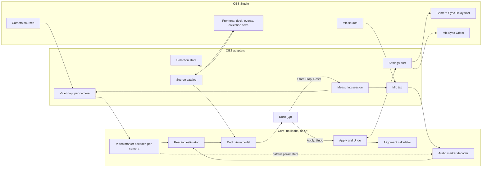
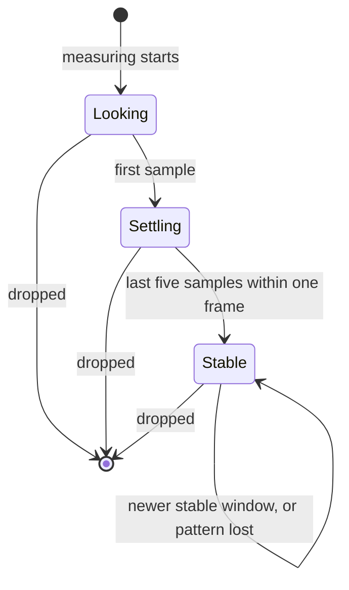
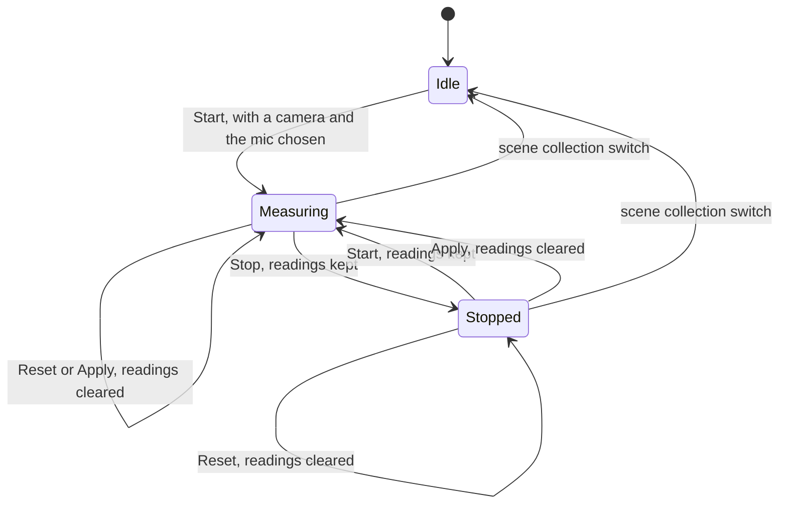

# TDD - Multi-Camera Sync

> The technical design for the plugin described in [`.design/multi-camera-sync.md`](../../.design/multi-camera-sync.md). The design's Key decisions and the ADRs in [`docs/adr/`](../adr/README.md) are binding: where this document disagrees with them, they win, and a changed decision gets a new ADR. Terms follow the design: camera, mic, pattern, reading, alignment, Apply, Undo.

| Field           | Value                                                                                     |
| --------------- | ----------------------------------------------------------------------------------------- |
| Tech Lead       | Vinicius Braz (@Vinnissaum)                                                               |
| Product Manager | Vinicius Braz (maintainer; no separate role)                                              |
| Team            | Vinicius Braz, solo                                                                       |
| Epic/Ticket     | None yet. Repository: `Vinnissaum/simple-audiosync-obs-plugin`                            |
| Design          | [Multi-Camera Sync](../../.design/multi-camera-sync.md), confirmed 2026-10-11             |
| Decisions       | [ADR-001 to ADR-008](../adr/README.md); 005 and 007 stay Proposed until the Reading spikes |
| Size            | Large: three slices and two spikes, several weeks of one developer's time                 |
| Status          | Draft                                                                                     |
| Created         | 2026-10-11                                                                                |
| Last Updated    | 2026-10-11                                                                                |

## Context

**Background.** OBS Studio users who run several cameras into one mic cannot align them inside OBS. Each camera reaches OBS with its own lag, and the mic's Sync Offset can match only one of them. Audio Video Sync Dock ("Sync Dock") measures that lag with a test video played on a phone, but only for the camera on Program, and it leaves applying the result to the user. This plugin measures every selected camera against the mic at once and writes the corrections into OBS's own controls: a Video Delay (Async) filter on each camera and the mic's Sync Offset.

**Current state.** The repository holds the design, eight ADRs and agent skills. There is no code. The development machine (WSL) has no OBS, CMake or cameras, so everything that needs OBS runs on a separate test rig: two cameras with different lags, a mic and a phone.

**Domain.** Audio/video synchronisation for live production, inside OBS. The plugin is native code in C and C++ against libobs, the OBS frontend API and Qt 6, built with OBS's official plugin template.

**Stakeholders.**

- Multi-camera OBS users (podcasts, events, PTZ rigs). They have the problem and judge the result on air.
- The maintainer, who ships the release and reviews it three months after the forum release.
- Sync Dock's author and users. The pattern and detector come from Sync Dock (GPL-2.0-or-later), and its users already own the pattern.
- The OBS forum community, where the plugin is published and supported.

**What this document adds to the design.** The design fixes what must hold. This document fixes how to build it:

- libobs behaviour, verified in the OBS 30.0 sources, that decides where the measuring taps can sit (next section);
- a component architecture with an OBS-free core, so every rule in the design runs in unit tests without OBS;
- the contracts between components, the alignment arithmetic with test vectors, and the persisted state;
- what the build must change in the plugin template to honour the 30.0 minimum and ship the promised packages;
- a phased plan that maps onto tlc-spec-driven features.

## Key technical findings

Each was checked against the OBS sources at the tag named, Sync Dock's main branch, or the plugin template's master branch (see References).

| #   | Finding                                                                                                                                                                                                                          | Consequence                                                                                                                                                                                         |
| --- | -------------------------------------------------------------------------------------------------------------------------------------------------------------------------------------------------------------------------------- | --------------------------------------------------------------------------------------------------------------------------------------------------------------------------------------------------- |
| 1   | Video Delay (Async) holds frames and releases them later with their original timestamps.                                                                                                                                         | A video tap must stamp each frame with the time OBS shows it, never with the frame's own timestamp, or every reading misses the camera's delay.                                                      |
| 2   | Async filters (Video Delay (Async) is one) run on the video tick for every source, shown or not. Effect filters (Render Delay is one) run only when the source is rendered, after every async filter.                            | A tap in the async stage cannot see Render Delay, which Key decision 3 requires a reading to include. A tap in the effect stage sees nothing for a camera that is not on screen anywhere.           |
| 3   | libobs saves every filter attached to a source with the scene collection; private filters are not exempt.                                                                                                                        | A measuring filter left on a camera while OBS saves ends up in the scene collection, and on a machine without the plugin it becomes a broken filter entry. Key decision 1 exists to prevent this.   |
| 4   | OBS 30.0 can render a private view into its own video mix, and every mix's frames carry the same render-loop timestamp as Program's.                                                                                            | The design's second tap candidate, a private mix per camera, works on OBS 30.0 and does not raise the minimum.                                                                                      |
| 5   | A source's audio callback receives samples with the device timestamps, before the Sync Offset and the timing adjustment the mix applies.                                                                                         | The mic tap adds the mic's current Sync Offset itself; spike 1 checks the result against Sync Dock.                                                                                                 |
| 6   | Sync Dock shows latency as audio time minus video time ("Audio lagged" when positive).                                                                                                                                          | A reading is video minus audio, so it equals minus Sync Dock's number. Spike comparisons flip the sign.                                                                                            |
| 7   | Every update to a Video Delay (Async) filter flushes its buffer: the camera holds its last frame until the new delay refills.                                                                                                    | Apply writes only values that change. On air, a changed camera pauses for up to its new delay, and the confirmation should say so.                                                                  |
| 8   | OBS 32.0 and later refuse a plugin built against a newer libobs; 30.x and 31.x do not check, so such a plugin breaks on whatever they lack. The template builds against obs-studio 31.1.1 on Windows and macOS, and against the PPA's latest OBS on Ubuntu. | Every platform must build against OBS 30.0 headers to honour the 30.0 minimum (Release default 3).                                                                                                 |
| 9   | The template packages Windows builds as a zip, macOS builds as a .pkg and Ubuntu builds as a .deb.                                                                                                                               | The Windows installer the Release slice promises is extra work. Sync Dock's Inno Setup installer is the precedent.                                                                                 |

## Problem Statement & Motivation

### Problems we're solving

- **Several cameras, one mic, one Sync Offset.** The Sync Offset can match one camera; whichever camera is on air, the others are out of sync.
  - Impact: users run a manual loop. They record a clap, measure every camera in a video editor, delay each faster camera, offset the mic, and repeat it whenever a camera changes. Nobody publishes how long that takes; the OBS Offset Calculator exists only to do its arithmetic (1,798 downloads in 13 months).
- **Corrections land in the wrong place.** Forum threads show Render Delay put on cameras, and users unaware that one camera can be delayed on its own.
  - Impact: wrong or unstable fixes, and latency added where it does not help.
- **The measuring tool that works measures one camera and applies nothing.** Sync Dock measures Program, so one camera at a time, and the user still types every value by hand.
  - Impact: the loop survives even for users who already own the tool.

### Why now

- Sync Dock's pattern and detector are proven (19,161 downloads) and GPL-2.0-or-later, so the hardest part already exists and can be reused.
- Nothing applies multi-camera corrections today. Klaps writes a Sync Offset only when exactly one audio source is on Track 1.
- The design is confirmed and its decisions are recorded. The next step is code.

### Impact of not solving

- Users keep the editor loop, and sync breaks on air whenever a camera changes.
- The project ships nothing; the design and ADRs stay on paper.

## Scope

### ✅ In scope (V1)

- **Reading:** measure every selected camera against one mic at the same time while a phone plays Sync Dock's pattern, with each camera's state shown in one dock.
- **Alignment:** one Apply writes a Video Delay (Async) filter named "Camera Sync Delay" on each camera and the mic's Sync Offset, all or nothing. One Undo restores the values from before the last Apply, for the current OBS session.
- The chosen cameras and mic, remembered per scene collection.
- **Release:** a Windows installer, an unsigned macOS .pkg and an Ubuntu .deb, built in CI; pattern files for common frame rates with every release; an OBS forum resource with a how-to.
- **Engineering:** an OBS-free core with unit tests in CI on all three platforms; integration tests for Apply and Undo against a headless libobs; a written rig protocol for the spikes and the acceptance runs.

### ❌ Out of scope (V1)

| Item                                                 | Why                                                                                  |
| ---------------------------------------------------- | ------------------------------------------------------------------------------------ |
| Drift during a session                               | The lag is treated as fixed; drift correction is a different product (design Boundary) |
| More than one mic                                    | One mic is the timing reference (design Boundary)                                    |
| Measuring without the phone and the pattern          | Device latency reports are unreliable (design Boundary)                              |
| Screen, window and game captures                     | Video Delay (Async) cannot delay them (design Boundary)                              |
| A camera's built-in mic as the reference             | The chosen mic is the reference (design Boundary)                                    |
| Building for single-camera users                     | Sync Dock and Klaps serve them; one camera still works (design Boundary)             |
| Flatpak; macOS signing and notarization              | Release defaults 2 and 1                                                             |
| Undo across OBS restarts, or beyond the last Apply   | Alignment default 1                                                                  |
| A delay filter type of the plugin's own              | ADR-001                                                                              |
| Telemetry or any network access                      | Not needed; see Security Considerations                                              |

### Never touched

Render Delay is never added or edited. Filters the user added are never edited, reordered or removed. Scenes, audio tracks, the mic's other properties and every other source stay as they are (design Boundary, Key decision 4).

### 🔮 Future considerations

- An echo-tolerant pattern and detector, if spike 2 fails. It would then move into V1, before Alignment.
- A guided Program walk-through ("one session"), if spike 1 fails. Also V1 in that case (ADR-007's fallback).
- Flatpak packaging, and signed and notarized macOS builds.
- An Undo that survives a restart.

## Technical Solution

### Architecture overview

The plugin has three layers.

1. **OBS adapters.** The only code that calls libobs or the frontend API: the measuring session's tap handling, the taps, the source catalog, the selection store, the settings port's OBS implementation and the frontend event handling.
2. **Core.** Plain C++ with no libobs and no Qt: the detector reworked from Sync Dock, the reading estimator, the alignment calculator, Apply and Undo over an abstract settings port, and the dock's view-model. It builds as a static library linked into both the plugin and the unit tests.
3. **Dock.** A thin Qt widget that renders the view-model and forwards clicks.

Every rule the design states (stability, the alignment arithmetic, all-or-nothing Apply, what the dock shows) lives in the core. It runs in tests on any machine with a compiler, with or without OBS, which gives tlc-spec-driven a test gate on CI and on the WSL machine.



### Components

| Component                        | Layer                                | Slice     | Responsibility                                                                                                                                                         | Thread                                            |
| -------------------------------- | ------------------------------------ | --------- | ---------------------------------------------------------------------------------------------------------------------------------------------------------------------- | ------------------------------------------------- |
| Plugin module                    | Adapter                              | All       | Registers the dock and the frontend callbacks; releases every tap before OBS exits                                                                                     | UI                                                |
| Source catalog                   | Adapter                              | Reading   | Lists cameras (sources Video Delay (Async) can delay) and mic candidates; preselects; reports removed, renamed and deactivated sources, filter changes and Sync Offset changes | UI                                                |
| Selection store                  | Adapter                              | Reading   | Saves and loads the chosen cameras and mic per scene collection                                                                                                        | UI                                                |
| Measuring session                | Adapter and core                     | Reading   | Start, Stop, Reset and collection switch; creates and releases taps; wires decoders to the estimator                                                                  | UI                                                |
| Video tap, per camera            | Adapter                              | Reading   | Delivers the camera's frames, stamped with the time Program would show them                                                                                            | The camera's private video mix                    |
| Mic tap                          | Adapter                              | Reading   | Delivers the mic's samples on the audio mix clock: device timestamp plus current Sync Offset                                                                           | The mic's audio thread                            |
| Video marker decoder, per camera | Core                                 | Reading   | QR decoding to pattern index and parameters; corner flash to video marker time                                                                                         | Same as its tap                                   |
| Audio marker decoder             | Core                                 | Reading   | Demodulates the pattern's sound with the parameters from the first camera to decode them; emits audio markers                                                          | Same as the mic tap                               |
| Reading estimator                | Core                                 | Reading   | Pairs each camera's video markers with the audio markers; keeps samples; decides stability; owns each camera's state                                                   | Any, under a lock; snapshot to UI ~10 times a second |
| Alignment calculator             | Core                                 | Alignment | Turns readings and current values into a plan or a refusal                                                                                                             | UI                                                |
| Apply and Undo                   | Core                                 | Alignment | Guards, reads, computes, writes changed values, verifies, restores on failure, keeps the Undo snapshot                                                                 | UI                                                |
| Settings port                    | Core contract, adapter implementation | Alignment | The only writer to OBS: the plugin's filter on each camera, the mic's Sync Offset, and the on-air state                                                                | UI                                                |
| Dock view-model                  | Core                                 | Both      | Computes every label, status and button state from the session, the estimator and the last Apply                                                                       | UI                                                |
| Dock                             | UI                                   | Both      | Camera checklist with each camera's status, mic picker, pattern link, Start/Stop, Reset, Apply, Undo, a message line                                                  | UI                                                |

### Threading and lifetimes

- **UI thread:** dock, catalog, session lifecycle, Apply, Undo and persistence. Every write to OBS happens here.
- **Each camera's private video mix** has its own video output thread. The tap and that camera's video decoder run there, so QR decoding, the heaviest work, spreads over one thread per camera. A camera whose decoding falls behind skips its own frames and nobody else's.
- **The mic's audio thread** runs the mic tap and the audio decoder, a few multiply-adds per sample, as in Sync Dock.
- **The graphics thread** runs nothing of the plugin's beyond what OBS does for any view.
- **The estimator** is the meeting point. Decoders push markers under a lock; the UI thread takes a snapshot about ten times a second.
- **Lifetimes:** taps hold weak references to their sources, so a removed source ends its tap. Taps are released on Stop, on deselection, on a collection switch and on OBS exit, always before libobs shuts down.

### Reading

#### Video tap

**Requirement:** a camera's frame time is when Program would show that frame if the camera were on air, with every current correction in place (Key decision 3), and every selected camera is measured at once (Key decision 6).

|                                                 | Tap B: private mix per camera                                                                                    | Tap A1: filter, async stage                                                  | Tap A2: filter, effect stage                                      |
| ----------------------------------------------- | ---------------------------------------------------------------------------------------------------------------- | ---------------------------------------------------------------------------- | ----------------------------------------------------------------- |
| Sees Video Delay (Async)                        | Yes                                                                                                              | Yes, if last                                                                 | Yes                                                               |
| Sees Render Delay and other effect filters      | Yes                                                                                                              | **No**: runs before them (finding 2)                                         | Yes, if last                                                      |
| Measures a camera not on screen anywhere        | Yes. The view renders it, and showing it keeps devices set to "deactivate when not showing" running             | Yes, if the device is running                                                | **No**: the effect stage runs only when the camera renders        |
| Frame time                                      | The render-loop time on the mix's frames, shared with Program (finding 4)                                       | Must be the video time of the tick that filters the frame (finding 1)        | The video time of the render                                      |
| Touches the camera's filter list                | No                                                                                                               | Adds a filter while measuring                                                | Adds a filter while measuring                                     |
| Scene collection hazard                         | None                                                                                                             | Saved with the collection if OBS saves while measuring (finding 3)           | Same as A1                                                        |
| Frame formats to handle                         | One: the mix delivers NV12, luma plane first                                                                     | Every source format: YUY2, UYVY, NV12, I420, RGB and more                    | RGBA texture readback                                             |
| Cost per camera                                 | A small render and readback each frame                                                                           | A CPU copy                                                                   | A readback plus an extra pass in Program's own render path        |
| Minimum OBS                                     | 30.0                                                                                                             | 30.0                                                                         | 30.0                                                              |

**Recommendation for spike 1:** try Tap B first. It is the only candidate that sees every filter, measures cameras that are not on air, and leaves the camera's filter list alone, which keeps Key decisions 1 and 4 intact while measuring. Keep A1 as a cheap comparator on a camera without effect filters. Put a Render Delay on one test camera so the spike proves the tap sees effect filters.

**Tap B's shape.** Per camera, a private view whose only channel is the camera, added to OBS's render loop with its own video mix: OBS's canvas frame rate, a small canvas (start at 640×360 for 16:9, aspect kept; the size is a spike parameter) and NV12 output. Each raw frame reaches the camera's decoder with the mix's frame timestamp. The view shows the camera without making it active, so tally and Program are untouched.

#### Mic tap

**Requirement:** audio markers on the clock of Program's audio, after the mic's Sync Offset (Key decision 3).

- **M1, chosen for spike 1: the mic's own audio callback.** It receives the mic's samples alone, already in OBS's sample format, with device timestamps that exclude the Sync Offset (finding 5). The tap adds the mic's current Sync Offset to every timestamp. For capture devices that stamp with the system clock, libobs's timing adjustment is zero; any residual shows up in spike 1's comparison.
- **M2, reference only: a track of the main audio mix,** which is what Sync Dock reads. It includes the Sync Offset by construction, but it mixes every source on that track. A camera's own audio that hears the phone adds a second copy of the pulses at another lag, and the plugin may not change track assignments. Spike 1 uses Sync Dock itself as the M2 reference.

#### Detector rework (ADR-005)

| Sync Dock today                                                                                                                       | In this plugin                                                                                                                                                                                     |
| ------------------------------------------------------------------------------------------------------------------------------------- | -------------------------------------------------------------------------------------------------------------------------------------------------------------------------------------------------- |
| One detector inside one OBS output, fed with Program's raw video and the main mix's audio                                            | A video half per camera and one audio half for the mic                                                                                                                                            |
| QR decoding (quirc) on a luma image halved until it holds no more pixels than 640×480; payload keys `q`, `i`, `f`, `c`, `t`, `I` with range checks | Kept, per camera                                                                                                                                                                      |
| Corner tracking and the flash zero-crossing, interpolated to sub-frame time                                                           | Kept, per camera                                                                                                                                                                                   |
| Audio: quadrature demodulation at the carrier `f`, symbol length set by `c`, preamble detection with the peak finder, an 8-bit index checked with CRC-4 | Kept, for the mic only. It starts when the first camera decodes `f` and `c`. Different parameters seen later are ignored until Reset: one pattern per session                     |
| One list pairing video and audio markers by index                                                                                     | One video marker list per camera against one shared audio marker list                                                                                                                             |
| OBS output wrapper, signals, debug monitor source                                                                                     | Dropped                                                                                                                                                                                            |
| libobs logging and integer helpers                                                                                                    | Injected, so the decoders build without libobs and run in unit tests                                                                                                                              |

Upstream copyright notices stay on every derived file (ADR-006, `CLAUDE.md`).

**Pattern cadence**, from Sync Dock's generator: each marker cycle is 3q frames, q frames of QR code followed by two flash phases. The shipped files use q = 4 at 60, 59.94 and 50 fps (a marker every 200 to 240 ms) and q = 2 at 24 and 23.98 fps (every 250 ms). Indices run from 0 to 255 and wrap, about every 51 seconds at five markers a second.

#### Reading arithmetic

- For pattern index k, Vᵢ(k) is the time camera i's tap shows marker k, and A(k) is the time of the mic's audio marker k after its Sync Offset. Each pair gives a sample rᵢ(k) = Vᵢ(k) − A(k), in ms. Positive means video late.
- A pair forms only when both markers carry the same index and lie less than half an index wrap apart: 25 s or more at the shipped cadences, above OBS's 20,000 ms limit.
- A camera's reading is **stable** when its last five samples span at most one frame (max minus min ≤ F), where F is OBS's canvas frame interval: 33.3 ms at 30 fps, 16.7 ms at 60 fps. The reading is the median of those five, rounded to whole milliseconds.
- **Sign:** a reading equals minus Sync Dock's latency (finding 6).

#### Camera states



A camera is dropped when it is removed, renamed or deactivated. Reset, a collection switch and a successful Apply clear every reading; a camera still selected and measured starts again at Looking. A stable reading survives losing the pattern (Key decision 6), and a newer stable window replaces its value.

#### Session



A collection switch also drops the Undo snapshot and loads the new collection's selection.

### Alignment

#### Arithmetic (Key decisions 2 and 3)

Inputs: each selected camera's reading rᵢ (whole ms, positive when video is late) and its plugin filter delay dᵢ (0 when it has none); the mic's current Sync Offset s (ms, negative if set that way by hand); the frame interval F.

1. A selected camera without a stable reading refuses Apply ("Waiting for {camera}").
2. If every reading lies within one frame (−F ≤ rᵢ ≤ F), nothing is written ("Already aligned").
3. Δ is the largest of every (rᵢ − dᵢ) and −s.
4. Each camera's new delay is dᵢ′ = dᵢ + Δ − rᵢ. The mic's new Sync Offset is s′ = s + Δ.
5. Any dᵢ′ or s′ above 20,000 ms refuses Apply ("{camera} needs more delay than OBS allows").

What this guarantees:

- After Apply every reading is about zero: rᵢ + (dᵢ′ − dᵢ) − (s′ − s) = 0.
- No written value is negative, because Δ is at least every lower bound.
- Δ is the smallest value that meets those bounds, and every written value grows with Δ, so the added latency is the least that aligns every camera with the mic.
- Whichever term sets Δ ends at 0, either that camera's plugin filter or the mic's Sync Offset, so the slowest path gains nothing. Δ can be negative, so the plugin's filters and the mic's Sync Offset can both shrink. A user's filter shows up in rᵢ and is never edited (Key decision 4).

Test vectors, with F = 33 ms:

| Case                                           | Before                                  | Δ   | After                      |
| ---------------------------------------------- | --------------------------------------- | --- | -------------------------- |
| Two cameras, no corrections                    | r = (+100, +40), d = (0, 0), s = 0      | 100 | d′ = (0, 60), s′ = 100     |
| Mic slower than every camera (wireless)        | r = (−50, −120), d = (0, 0), s = 0      | 0   | d′ = (50, 120), s′ = 0     |
| Re-apply adds the remainder                    | r = (+40, +40), d = (0, 60), s = 100    | 40  | d′ = (0, 60), s′ = 140     |
| The plugin's filter over-delays a camera       | r = (+150, +30), d = (200, 0), s = 100  | 30  | d′ = (80, 0), s′ = 130     |
| The mic's Sync Offset is larger than needed    | r = (−50, −30), d = (0, 0), s = 100     | −30 | d′ = (20, 0), s′ = 70      |
| A user's own 500 ms filter on camera 1         | r = (+480, +30), d = (0, 0), s = 0      | 480 | d′ = (0, 450), s′ = 480    |
| Hand-set negative Sync Offset                  | r = (+60, +10), d = (0, 0), s = −200    | 200 | d′ = (140, 190), s′ = 0    |
| Already aligned                                | r = (+20, −30)                          | n/a | nothing written            |

The last-but-one row shows what Key decision 2 costs: keeping the −200 ms offset would have aligned with Δ = 60, so "never negative after Apply" adds 140 ms on every path. That is the design's choice, stated here so nobody files it as a bug.

#### Apply (Key decisions 1, 4 and 7)

1. Refuse if any selected camera lacks a stable reading. Nothing is read or written.
2. Stop if every reading is within one frame ("Already aligned").
3. If streaming or recording is active, ask first. Cancel ends here.
4. Resolve every selected camera and the mic by UUID. If any is gone, refuse; nothing is written.
5. Read each camera's plugin filter (present or not, and its delay) and the mic's Sync Offset. This is both the restore point and the Undo snapshot.
6. Compute the plan. Refuse if a value passes 20,000 ms.
7. Log the whole plan, then write only the values that change: the cameras first, then the mic. A camera that needs a non-zero delay and has no plugin filter gets one.
8. After each write, read the value back. On any failure, restore every value from step 5 in reverse order, remove the filters step 7 created, and show "Apply failed - nothing changed".
9. On success, keep the step-5 values for Undo, clear every reading, and keep measuring (resuming if stopped).

Every step runs on the UI thread inside one call, so nothing in the plugin interleaves with it. libobs writes are not transactional, so a crash between steps 7 and 9 can still leave part of the plan written; the plan logged in step 7 is the way back by hand (ADR-008).

**Undo** restores the step-5 values exactly, the Sync Offset to the nanosecond, and removes filters that Apply created. It uses the same resolve, write, verify and restore path, so it is all-or-nothing too. It overwrites hand edits made after Apply (ADR-008). It holds one Apply and lives in memory: an OBS restart, a scene collection switch or a newer Apply drops it.

#### The plugin's filter

- Type: Video Delay (Async), OBS id `async_delay_filter`, setting `delay_ms` in whole milliseconds from 0 to 20,000.
- Name: "Camera Sync Delay", the working name that follows the product name (Alignment default 3). The adapter recognises a list of names, the current one plus any former product name, so a rename never adds a second filter (ADR-004).
- Created by the first Apply that gives the camera a non-zero delay, as a normal filter that OBS saves with the collection, at the end of the camera's filter list. After that it is edited, down to 0 when the alignment says so. Only Undo, or a failed Apply's restore, removes a filter the plugin created.
- A user who renames it turns it into a user filter; a user who deletes it leaves the camera without one. Either way the next reading includes the change, and the next Apply creates a new filter if needed.

### Internal contracts

Contracts between components, stated as data. Times are in nanoseconds on OBS's clock unless marked ms.

| From → to                    | Carries                                                                                                                              | Notes                                                                       |
| ---------------------------- | ------------------------------------------------------------------------------------------------------------------------------------ | --------------------------------------------------------------------------- |
| Video tap → video decoder    | Luma plane (data, width, height, stride) and frame time                                                                              | The frame time is when Program would show the frame (finding 1)             |
| Mic tap → audio decoder      | Planar float samples, frame count, sample rate, channel count, time of the first sample                                              | The time already includes the mic's Sync Offset                             |
| Video decoder → estimator    | Video marker: camera, index, time, pattern parameters (`f`, `c`, `q`, index wrap)                                                    | The parameters also reach the audio decoder; the first ones win             |
| Audio decoder → estimator    | Audio marker: index, time                                                                                                            |                                                                             |
| Estimator → view-model       | Per camera: state (looking, settling, stable), latest sample in ms, reading in ms, sample count. Session: time since the last audio marker | A snapshot copied under the lock                                            |
| View-model → dock            | Rows (camera name, status text, ticked), mic picker state, message line, enabled buttons and their tooltips                          | All text comes from the locale file                                         |

**Alignment calculator.** In: readings, current camera delays, current Sync Offset, frame interval, the 20,000 ms limit. Out: a plan (each camera's old and new delay, the mic's old and new offset) or a refusal (waiting for a camera, already aligned, over the limit for a named source). Same inputs always give the same output.

**Settings port.** The only way the core touches OBS.

| Operation                                 | Result                                       |
| ----------------------------------------- | -------------------------------------------- |
| Resolve a source by UUID                  | Present or gone                              |
| Read a camera's plugin filter             | Absent, or present with its delay in ms      |
| Write a camera's plugin filter delay      | Creates the filter if absent; ok or failed   |
| Remove a plugin filter that Apply created | Ok or failed                                 |
| Read the mic's Sync Offset                | Nanoseconds                                  |
| Write the mic's Sync Offset               | Ok or failed                                 |
| Is OBS streaming or recording             | Yes or no                                    |

The port has no operation that reaches another filter, another property or another source, which makes Key decision 4 structural rather than a matter of care. Unit tests run Apply and Undo against a fake port that can fail any chosen write.

### OBS integration points

Every mechanism below exists in the OBS 30.0 headers.

| Need                       | libobs or frontend mechanism                                                                    | Notes                                                                                            |
| -------------------------- | ----------------------------------------------------------------------------------------------- | ------------------------------------------------------------------------------------------------ |
| Register the dock          | `obs_frontend_add_dock_by_id`                                                                   | As Sync Dock does                                                                                |
| Find cameras               | Source output flags with async video (`OBS_SOURCE_ASYNC_VIDEO`)                                | Webcams, capture cards, media and NDI sources qualify; screen, window and game captures do not  |
| Identify sources           | Source UUIDs (`obs_source_get_uuid`, `obs_get_source_by_uuid`)                                  | Stable across renames                                                                            |
| React to changes           | Source signals: remove, rename, filter add and remove, `audio_sync` (Sync Offset changed)      |                                                                                                  |
| Preselect from Program     | The current Program scene from the frontend                                                     | Cameras inside nested scenes and groups count                                                    |
| Scene collection lifecycle | Frontend events: collection changing and changed, finished loading, exit                        | Taps are released on changing and on exit                                                        |
| Remember the selection     | Frontend save callback, per-collection module data                                              |                                                                                                  |
| On-air check               | Frontend streaming-active and recording-active queries                                          |                                                                                                  |
| Tap B                      | Private view with its own video mix (`obs_view_add2`); raw frames from that mix's video output | Frames carry the render-loop timestamp (finding 4)                                               |
| Mic tap                    | Source audio capture callback                                                                   | Timestamps exclude the Sync Offset (finding 5)                                                   |
| Sync Offset                | Source sync offset get and set, in nanoseconds                                                  | OBS's dialog allows −950 to 20,000 ms; the plugin writes 0 to 20,000                             |
| Plugin filter              | Create `async_delay_filter` with `delay_ms`, add it to the camera, find it by name, remove it  | 0 to 20,000 ms                                                                                   |

Frontend calls that changed between OBS 30 and 31 (the global config accessor Sync Dock switches on) are avoided; any plugin setting lives in the plugin's own config file.

### Persisted state

| Where                                    | What                                       | Written by         | Lifetime                                              | Without the plugin                        |
| ---------------------------------------- | ------------------------------------------ | ------------------ | ----------------------------------------------------- | ----------------------------------------- |
| Scene collection, each camera's filters  | "Camera Sync Delay" and its `delay_ms`     | Apply, Undo        | Until the user changes it                             | Keeps working (Key decision 1)            |
| Scene collection, the mic                | Sync Offset                                | Apply, Undo        | Until changed                                         | Keeps working                             |
| Scene collection, module data            | The selection (schema below)               | The save callback  | Per collection                                        | Ignored, then dropped at the next save    |
| Memory                                   | Markers, samples, readings                 | Reading            | Until Apply, Reset, a collection switch or exit      | n/a                                       |
| Memory                                   | Undo snapshot                              | Apply              | Until the next Apply, Undo, a collection switch or exit | n/a                                       |
| OBS log                                  | Lifecycle, plans, results                  | Every component    | OBS's log rotation                                    | n/a                                       |

The selection, per scene collection:

```json
{
  "version": 1,
  "cameras": ["8b1f3c2e-…", "d47a90b1-…"],
  "mic": "5c0e7f44-…"
}
```

UUIDs that no longer resolve are ignored. With no saved selection, the dock preselects as the design's Reading table says. An unknown `version` counts as no saved selection.

The Undo snapshot, in memory:

```json
{
  "collection": "Podcast",
  "cameras": [
    { "source": "8b1f3c2e-…", "filterExisted": false, "delayMs": 0 },
    { "source": "d47a90b1-…", "filterExisted": true, "delayMs": 120 }
  ],
  "mic": { "source": "5c0e7f44-…", "syncOffsetNs": -50000000 }
}
```

### Dock

- One dock under Docks: the camera checklist with each camera's status, the mic picker, a link to the pattern files, Start/Stop, Reset, Apply, Undo and a message line.
- The view-model owns every string, taken from the design's state tables through the locale file, en-US first: "Looking for the pattern", "+142 ms - video late", "−60 ms - video early", "settling", "Pick at least one camera and the mic", "No pattern sound from {mic} - bring the phone closer or unmute it", "Waiting for {camera}", "Already aligned", "Shift {n} cameras and the mic while on air?", "{camera} needs more delay than OBS allows", "Apply failed - nothing changed", "Aligned".
- Values show whole milliseconds with an explicit sign.
- The mic picker leaves out sources checked as cameras (Open question 5).

### Error handling

| Scenario                                                        | Handling                                                                         | User sees                                                              |
| --------------------------------------------------------------- | -------------------------------------------------------------------------------- | ---------------------------------------------------------------------- |
| No camera or no mic chosen                                      | Start disabled                                                                   | "Pick at least one camera and the mic"                                 |
| A camera never decodes a QR code                                | Its row waits; the other cameras carry on                                        | "Looking for the pattern"                                              |
| Cameras see the pattern, no audio marker for 5 s                | No samples; measuring continues                                                  | "No pattern sound from {mic} - bring the phone closer or unmute it"    |
| A QR payload malformed or out of range                          | Ignored, logged at debug level                                                   | Nothing                                                                |
| A second pattern with other parameters                          | Ignored until Reset                                                              | That camera stays "Looking for the pattern"                            |
| A camera's tap cannot be created                                | That camera is not measured; warning in the log                                  | "Looking for the pattern"                                              |
| A camera removed, renamed or deactivated                        | Reading dropped, tap released                                                    | The camera leaves the list                                             |
| The mic removed                                                 | Measuring stops; Apply is refused until a mic is chosen                          | "Pick at least one camera and the mic"                                 |
| A correction changed by hand while readings are kept            | The affected readings are dropped (Open question 6)                              | Those cameras start again                                              |
| Apply with a camera not stable                                  | Refused                                                                          | "Waiting for {camera}"                                                 |
| Apply with every camera within a frame                          | Nothing written                                                                  | "Already aligned"                                                      |
| Apply on air                                                    | Asks first                                                                       | "Shift {n} cameras and the mic while on air?"                          |
| A value over 20,000 ms                                          | Refused                                                                          | "{camera} needs more delay than OBS allows"                            |
| A source gone before writing, or a write fails                  | Everything restored                                                              | "Apply failed - nothing changed"                                       |
| The restore itself fails                                        | Every intended and actual value logged as a warning; Undo not offered            | Proposed: "Apply failed - check the log" (Open question 8)             |
| Video Delay (Async) unavailable (obs-filters not loaded)        | Apply refused before any write                                                   | "Apply failed - nothing changed"                                       |
| Undo with a source gone                                         | Refused; nothing changed                                                         | Proposed: "Undo failed - nothing changed" (Open question 8)            |

### Build, packaging and CI

The build follows OBS's plugin template: CMake presets for Windows (Visual Studio 2022), macOS (Xcode, universal binary) and Ubuntu 24.04 (Ninja), and GitHub Actions workflows for push, pull request, manual dispatch, the build itself and format checks. A semantic-version tag on main creates a draft release with packages attached. The template needs these changes:

| Change                                                                                                                            | Why                                                                                                                           |
| --------------------------------------------------------------------------------------------------------------------------------- | ----------------------------------------------------------------------------------------------------------------------------- |
| Build against OBS 30.0 headers on every platform, with obs-deps and Qt from the same release; the .deb's dependency accepts OBS 30 | Finding 8. Ubuntu stops using the PPA's latest headers; Sync Dock builds once per OBS major for the same reason             |
| Turn on the frontend API and Qt                                                                                                   | The dock                                                                                                                      |
| Add the core library, the unit-test executable and a CTest step to every CI build job                                             | The template ships no tests, and tlc-spec-driven's gate needs them                                                            |
| Add a configuration that builds only the core and its tests, with no libobs, Qt or OBS dependencies to fetch                     | The template's configure step requires libobs; this one lets the unit tests run on WSL and in a fast CI job                   |
| Add a Linux job for the headless libobs integration tests                                                                         | Apply and Undo against real OBS objects                                                                                       |
| Add a Windows installer (Inno Setup) next to the zip                                                                              | Finding 9; the Release slice                                                                                                  |
| Ship the macOS .pkg unsigned, with the Gatekeeper steps in the how-to                                                             | Release default 1                                                                                                             |
| Generate the pattern files in CI with Sync Dock's generator (Python, Pillow, qrcode, ffmpeg) at 60, 59.94, 50, 24 and 23.98 fps, and attach them to each release | The Release slice; ADR-005                                                                                                    |
| Add quirc as a pinned submodule, as Sync Dock does                                                                                | QR decoding                                                                                                                   |

## Risks

| Risk                                                                                         | Impact | Probability                | Mitigation                                                                                                                                                                         |
| -------------------------------------------------------------------------------------------- | ------ | -------------------------- | ---------------------------------------------------------------------------------------------------------------------------------------------------------------------------------- |
| No per-camera tap reproduces Program's timing within one frame (ADR-007)                     | High   | Medium                     | Spike 1 before any Reading code, Tap B first, stop after three rig days. Fallback: ADR-007's option B, a guided Program walk-through; "one pass" becomes "one session"            |
| Sync Dock's detector cannot hold a stable reading in an ordinary room (ADR-005)              | High   | Medium                     | Spike 2 before Alignment. Fallback: an echo-tolerant detector under a new ADR, which delays Alignment                                                                             |
| The chosen tap misses effect filters such as Render Delay (finding 2)                        | High   | High if Tap A1 is chosen   | Tap B first; spike 1 puts a Render Delay on one camera                                                                                                                             |
| A measuring filter leaks into the scene collection (finding 3)                               | High   | Medium if a Tap A wins     | Tap B needs no filter. If a Tap A wins: attach it only while measuring, remove it on Stop, collection change and exit, remove leftovers at load, and say so in the how-to         |
| The mic tap's timestamps are off the mix clock (finding 5)                                   | High   | Medium                     | Add the current Sync Offset; spike 1 compares with Sync Dock, which reads the mix                                                                                                 |
| The build targets a newer libobs than users run (finding 8)                                  | High   | High with template defaults | Pin OBS 30.0 headers everywhere; load the built plugin in OBS 30.0 and in the latest stable on the rig before every release                                                       |
| Measuring several cameras costs enough CPU or GPU that Program drops frames                  | Medium | Medium                     | Small per-camera canvas, decoding off the graphics thread, one thread per camera; measure four cameras on the rig against the performance targets                                 |
| A crash mid-Apply leaves a partial alignment (ADR-008)                                       | Medium | Low                        | Fixed write order, the plan logged before writing, read-back after each write, Undo                                                                                               |
| Readings go stale when the user edits a correction by hand before Apply                      | Medium | Low                        | Drop affected readings on a filter or Sync Offset change (Open question 6); Apply clears readings after writing                                                                   |
| Delays above the camera, such as filters on scenes or groups, are invisible to a per-camera tap | Medium | Low                        | Spike 1's comparison with Sync Dock exposes them; the how-to says so; readings stay correct relative to each other                                                                |
| An on-air Apply visibly freezes the delayed cameras (finding 7)                              | Medium | Medium                     | Write only changed values; the confirmation says cameras may pause                                                                                                                |
| The filter is found by name, so a user rename or a product rename duplicates it (ADR-004)    | Low    | Medium                     | The recognised-names list; documented                                                                                                                                              |
| Rig time is scarce: one developer, no OBS on the development machine                         | Medium | High                       | An OBS-free core tested anywhere; CI on three platforms; spike recordings replayed as fixtures; rig sessions batched                                                              |
| Install friction from the unsigned macOS package and the missing Flatpak                     | Medium | Medium                     | Gatekeeper steps in the how-to; the forum page lists what is supported                                                                                                            |
| GPL obligations missed in reused files or packages                                           | Low    | Low                        | Notices kept on derived files; licence in every package; source tagged per release                                                                                                |

## Implementation Plan

| Phase                  | Task                 | Description                                                                                                                                                                       | Owner    | Status        | Estimate |
| ---------------------- | -------------------- | --------------------------------------------------------------------------------------------------------------------------------------------------------------------------------- | -------- | ------------- | -------- |
| **0. Foundation**      | Scaffold             | Project from the plugin template, frontend API and Qt on, GPL-2.0-or-later licence file, working name "Camera Sync"                                                              | Vinicius | TODO          | 0.5 d    |
|                        | Pin OBS 30.0         | OBS 30.0 headers, obs-deps and Qt on Windows, macOS and Ubuntu; confirm the built plugin reports 30.0                                                                           | Vinicius | TODO          | 1 d      |
|                        | Core and tests       | Core static library, unit-test executable, a CTest step in every CI job                                                                                                          | Vinicius | TODO          | 0.5 d    |
|                        | Empty dock           | Dock registered, log prefix, loads in OBS 30.0 and the latest stable on the rig                                                                                                  | Vinicius | TODO          | 0.5 d    |
|                        | Vendor the detector  | Sync Dock's detector and quirc (pinned) with their notices, building in the core without libobs                                                                                  | Vinicius | TODO          | 1 d      |
|                        | Document the build   | Toolchain, build, install and test instructions in `CLAUDE.md`, as it asks                                                                                                       | Vinicius | TODO          | 0.25 d   |
| **1. Spikes (rig)**    | Spike 1: tap         | Tap B per camera and mic tap M1, instrumented. Two cameras with different lags, one with a Render Delay; compare with Sync Dock, sign flipped; three runs in a row; stop at three rig days | Vinicius | Blocked: rig  | ≤ 3 d    |
|                        | Spike 2: detector    | Phone within arm's reach of the mic in an ordinary room; three runs at each of two distances                                                                                     | Vinicius | Blocked: rig  | 1 d      |
|                        | Record outcomes      | Accept or supersede ADR-005 and ADR-007; keep the marker logs as replay fixtures                                                                                                 | Vinicius | TODO          | 0.25 d   |
| **2. Reading**         | Source catalog       | Camera and mic lists, preselection, the remove, rename, deactivate and change signals                                                                                            | Vinicius | TODO          | 1 d      |
|                        | Selection store      | Per-collection selection by UUID, versioned                                                                                                                                      | Vinicius | TODO          | 0.5 d    |
|                        | Taps                 | The spike's video tap and the mic tap, with their lifetimes                                                                                                                      | Vinicius | TODO          | 2 d      |
|                        | Detector rework      | Per-camera video decoders, one audio decoder, the parameter hand-off                                                                                                             | Vinicius | TODO          | 2 d      |
|                        | Estimator and session | Pairing, stability, camera states; Start, Stop, Reset, collection switch                                                                                                        | Vinicius | TODO          | 1.5 d    |
|                        | Dock                 | View-model and Qt dock for every Reading row; locale strings                                                                                                                     | Vinicius | TODO          | 1.5 d    |
|                        | Rig acceptance       | Every Reading row on the rig                                                                                                                                                     | Vinicius | TODO          | 0.5 d    |
| **3. Alignment**       | Calculator           | The arithmetic, with this document's test vectors                                                                                                                                | Vinicius | TODO          | 0.5 d    |
|                        | Settings port        | The OBS implementation: plugin filter by name, Sync Offset, on-air state                                                                                                         | Vinicius | TODO          | 1 d      |
|                        | Apply                | Guards, read, plan, write changed values, verify, restore, Undo snapshot                                                                                                         | Vinicius | TODO          | 1.5 d    |
|                        | Undo and dock        | Undo, the on-air confirmation, limits, "Already aligned", "Aligned"                                                                                                              | Vinicius | TODO          | 1 d      |
|                        | Integration tests    | Headless libobs: Apply, Undo and a failure mid-Apply against real sources                                                                                                        | Vinicius | TODO          | 1.5 d    |
|                        | Rig acceptance       | Every camera within one frame after one pass, three runs; every Alignment row                                                                                                    | Vinicius | TODO          | 0.5 d    |
| **4. Release**         | Windows installer    | Inno Setup installer next to the zip                                                                                                                                             | Vinicius | TODO          | 1 d      |
|                        | macOS and Ubuntu     | Unsigned .pkg with the Gatekeeper steps; .deb against OBS 30.0 headers                                                                                                           | Vinicius | TODO          | 1 d      |
|                        | Pattern files        | Generated in CI with Sync Dock's tool, attached to releases, linked from the dock                                                                                                | Vinicius | TODO          | 0.5 d    |
|                        | Clean installs       | A fresh machine per platform, on OBS 30.0 and the latest stable                                                                                                                  | Vinicius | TODO          | 1 d      |
|                        | Forum release        | How-to (pattern, measuring, Apply, Undo, manual revert, RAM note, minimum OBS, no Flatpak), tag, publish                                                                         | Vinicius | TODO          | 1 d      |
| **5. Review**          | Three-month review   | Downloads, support reports, cameras that never got a reading                                                                                                                     | Vinicius | TODO          | 0.5 d    |

**Total estimate:** about 28 working days, roughly six weeks for one developer, plus rig setup and waiting. Spike results can move this by weeks: a failed spike 2 adds a detector project before Alignment.

**Order and dependencies:**

- Foundation comes before the spikes, which run inside the scaffold; if Tap B passes, its spike code becomes Reading's starting point.
- Both spikes come before Reading's specification, because they decide ADR-005 and ADR-007, and with them the tap and the detector.
- Reading, then Alignment, then Release, as the design orders. CI produces installable packages from Foundation on, so the rig always tests real builds.

### Running the plan with tlc-spec-driven

tlc-spec-driven fits phases 0, 2, 3 and 4. The spikes stay outside it: they are experiments judged on the rig, not tasks with a test gate.

| Phase | tlc feature  | Size    | Notes                                                                                                     |
| ----- | ------------ | ------- | --------------------------------------------------------------------------------------------------------- |
| 0     | `foundation` | Medium  | Gate: CI green on three platforms; the plugin loads on the rig                                            |
| 2     | `reading`    | Complex | The design's Reading table is the acceptance criteria; Open questions 3 to 7 and 9 are the gray areas     |
| 3     | `alignment`  | Large   | The test vectors and the Apply steps become criteria; the fake port carries the failure-injection tests   |
| 4     | `release`    | Medium  | Gates are CI packages and clean-machine installs                                                          |

- **Acceptance criteria:** each row of a design state table becomes at least one EARS criterion. The suggested IDs below keep the trace from design to test.
- **Decisions:** the ADRs stay the decision log. `STATE.md` points to `docs/adr/` instead of copying it, and a changed decision is still a new ADR (`CLAUDE.md`).
- **Gates:** core tasks gate on unit tests, which run on CI and on WSL once a compiler and CMake are installed there. Adapter and dock tasks gate on the CI build plus a rig check through tlc's interactive UAT.
- **Verifier:** its discrimination sensor has the most to bite on in the core: the arithmetic, stability and the transaction.

Suggested requirement IDs:

| ID       | Design row                                                                                          | Main components                         |
| -------- | --------------------------------------------------------------------------------------------------- | --------------------------------------- |
| READ-01  | Dock opened: cameras listed, Program's preselected; the mic preselected only with exactly one audio input | Source catalog, view-model              |
| READ-02  | Start with no camera or no mic                                                                      | View-model                              |
| READ-03  | A camera has not seen the pattern                                                                   | Estimator, view-model                   |
| READ-04  | Cameras see the pattern, the mic hears nothing                                                      | Audio decoder, estimator, view-model    |
| READ-05  | Markers disagree by more than one frame: settling                                                   | Estimator                               |
| READ-06  | The last five markers agree within one frame: stable                                                | Estimator                               |
| READ-07  | A stable camera loses the pattern: reading kept                                                     | Estimator                               |
| READ-08  | A camera removed, renamed or deactivated                                                            | Source catalog, session                 |
| READ-09  | Stop, Reset, collection switch                                                                      | Session                                 |
| READ-10  | The selection remembered per scene collection (listed under "What Apply writes" in the design)     | Selection store                         |
| ALIGN-01 | A camera without a stable reading                                                                   | Apply                                   |
| ALIGN-02 | Already aligned                                                                                     | Calculator                              |
| ALIGN-03 | Streaming or recording: ask first                                                                   | Apply, settings port                    |
| ALIGN-04 | A correction past OBS's limits                                                                      | Calculator                              |
| ALIGN-05 | Apply succeeds: values written, Undo kept, readings cleared                                         | Apply, settings port                    |
| ALIGN-06 | A write fails partway: everything restored                                                          | Apply                                   |
| ALIGN-07 | Re-measured within one frame: Aligned                                                               | View-model                              |
| ALIGN-08 | Re-measured and still off: Apply adds the remainder                                                 | Calculator                              |
| ALIGN-09 | Undo restores the values from before the last Apply                                                 | Apply                                   |
| ALIGN-10 | Undo after a restart: not offered                                                                   | Apply, view-model                       |
| ALIGN-11 | One plugin filter per camera, found by name                                                         | Settings port                           |
| ALIGN-12 | The mic's Sync Offset never negative after Apply                                                    | Calculator                              |
| REL-01   | Windows installer                                                                                   | CI                                      |
| REL-02   | macOS unsigned package with the Gatekeeper steps                                                    | CI, how-to                              |
| REL-03   | Ubuntu .deb                                                                                         | CI                                      |
| REL-04   | Flatpak not supported, and the forum page says so                                                   | Forum page                              |
| REL-05   | OBS older than the minimum: not loaded, minimum stated                                              | Build, forum page                       |
| REL-06   | Pattern files with every release                                                                    | CI, dock                                |

## Security Considerations

The plugin has no network access, collects nothing, and runs inside OBS with the user's privileges. Its exposure is untrusted input, the user's scene collection and the supply chain.

- **Untrusted input.** QR payloads come from whatever a camera sees. The decoder bounds and terminates the payload, parses only known keys, and range-checks each value as Sync Dock does (`f` from 10 to 32,000, `c` from 1 to `f`, `q` from 1 to 1,000 ms, `i` from 0 to 255); anything else is ignored. The payload parser gets a fuzz test. Frame and audio queues are bounded and drop their oldest entry.
- **The scene collection.** Writes go only through the settings port, whose operations reach the plugin's filter and the mic's Sync Offset and nothing else (Key decision 4). Every Apply logs its plan before writing.
- **Personal data.** None is collected. The OBS log receives source names, as OBS's own log already does.
- **Supply chain.** OBS sources, obs-deps and Qt are pinned with hashes in the build spec; quirc is pinned to a commit; CI actions are pinned to commit SHAs. Each release publishes SHA-256 sums of its packages, which matters more because the macOS package is unsigned and users bypass Gatekeeper to install it.
- **Licences.** The plugin is GPL-2.0-or-later (ADR-006): upstream notices stay on every file derived from Sync Dock, the licence text ships in every package, and each release's source is tagged. quirc is ISC, which is GPL-compatible, and its notice ships too.

## Testing Strategy

| Test type      | Scope                                                                                                                                                     | Coverage target                                                                                         | Approach                                                                                                       |
| -------------- | --------------------------------------------------------------------------------------------------------------------------------------------------------- | ------------------------------------------------------------------------------------------------------- | -------------------------------------------------------------------------------------------------------------- |
| Unit           | Core: alignment arithmetic, stability, pairing, camera and session states, Apply and Undo over a fake port, view-model text and button states, selection rules, QR payload parsing | Every row of the design's Reading and Alignment tables; every test vector; at least 90% line coverage of the core | A header-only C++ test framework (doctest by default) run through CTest, on Windows, macOS, Ubuntu and WSL     |
| Detector       | Video and audio decoders on generated and recorded input                                                                                                  | Every index decoded; marker times within 1 ms of truth on generated input                               | Fixtures cut from Sync Dock's generated pattern with known offsets injected; spike recordings replayed         |
| Fuzz           | The QR payload parser                                                                                                                                     | No crash; no out-of-range value accepted                                                                | A fuzz target run in CI for a fixed time                                                                       |
| Integration    | The OBS adapter: plugin filter create, find, update and remove; Sync Offset; Apply and Undo; a source removed mid-Apply                                   | Every settings port operation; the restore path                                                         | Headless libobs on Linux CI with obs-filters loaded and a test async source. If libobs cannot start headless on CI, these run on the rig |
| Build          | The plugin builds and packages on three platforms                                                                                                         | Every push and pull request                                                                             | The template's workflows plus CTest                                                                            |
| Rig acceptance | Real cameras, mic and phone                                                                                                                               | Both spikes; every state table row; three Apply runs                                                    | The protocol below, through tlc's interactive UAT                                                              |
| Performance    | Measuring with two to four cameras                                                                                                                        | The Performance Requirements                                                                            | OBS's stats on the rig                                                                                         |

**Unit scenarios that matter most:**

- Arithmetic: the eight test vectors; rounding; the 20,000 ms limit on a camera and on the mic; a single camera.
- Stability: five samples within F become stable; one outlier keeps settling; F at 30 and 60 fps; the index wrap at 255.
- Pairing: audio before video and after it; a missed marker; a repeated index after a wrap.
- Apply: refusal before any read; "Already aligned" writes nothing; cancelling on air writes nothing; a failure at each write position restores every value and removes created filters; unchanged values are not written; Undo restores exactly, including a negative Sync Offset to the nanosecond.
- Session: Stop keeps readings; Reset clears them; a collection switch clears readings and Undo; Apply clears readings and resumes measuring.

**Fixtures.** Short clips derived from the pattern files and kept small (a few seconds of low-resolution luma frames and 48 kHz audio), with the steps to regenerate them. Spike 1's instrumented runs log every marker with its time; those logs become replay fixtures for the estimator.

**Rig protocol, for spike 1 and acceptance:**

1. Two cameras with clearly different lags (a phone webcam app works as the second), one carrying a Render Delay; one mic; the pattern at OBS's canvas frame rate or twice it.
2. Sync Dock installed. Put each camera on Program in turn and note Sync Dock's latency. This plugin's reading for that camera must equal minus that value within one frame.
3. Three runs in a row. Then Apply and measure again: every camera within one frame.
4. Record the OBS version, canvas resolution and frame rate, devices, phone distances, and the marker logs.

## Monitoring & Observability

A desktop plugin has no dashboards. Its observability is the OBS log, the dock itself and the forum.

**Log format.** One line per event, prefixed and in `key=value` form, so a support log can be searched:

```
[camera-sync] measure.start cameras=3 mic="Shure MV7" canvas_fps=30
[camera-sync] reading.stable camera="Cam B" reading_ms=+142 spread_ms=9
[camera-sync] apply.plan camera="Cam A" delay_ms=0->60 camera="Cam B" delay_ms=0->0 mic="Shure MV7" sync_offset_ms=0->100
[camera-sync] apply.result ok written=2 skipped=1 duration_ms=4
[camera-sync] apply.result failed step=camera:"Cam B" restored=yes
[camera-sync] undo.result ok
```

**What to log:**

- Info: load and version (with quirc's), Start, Stop, Reset, each stable reading, every Apply plan and result, Undo.
- Warning: refusals, a failed write, a failed restore with every intended and actual value, a tap that could not be created.
- Debug, shown when OBS logs verbosely (its `--verbose` start option): every marker with its time, the QR parameters, frames skipped per camera. Spikes and support read this level.

**What not to log:** audio, images, or anything about the user beyond the source names OBS already logs.

**Dock diagnostics (P3).** Each camera row can show markers received and missed, as Sync Dock shows its "missed" percentage, behind a details toggle so support can ask for a screenshot.

**Product signals:**

| Signal                                                     | Where                  | Response                                                                                        |
| ---------------------------------------------------------- | ---------------------- | ----------------------------------------------------------------------------------------------- |
| A camera never got a reading in a user's first session     | Forum thread, issues   | The design's early warning. Ask for a debug log; check QR and audio marker counts               |
| Apply failed or left something partial                     | Issues                 | Ask for the log; the plan line gives every value to restore                                     |
| The plugin will not load                                   | Issues                 | Compare the OBS version with the minimum and the module version in the log                      |
| Downloads and ratings                                      | Forum resource page    | The three-month review                                                                          |

## Rollback Plan

### For a user, in the app

- **Undo** restores the values from before the last Apply in one click, for the current session.
- **By hand:** every value the plugin writes is visible in OBS, in the "Camera Sync Delay" filter of each camera and in the mic's Sync Offset in Advanced Audio Properties. Deleting the filter and putting the offset back undoes any Apply, including one from an earlier session. The how-to documents this.
- **Removing the plugin** leaves the alignment working, by design (Key decision 1). It does not roll the alignment back.

### For a release

- Each release is a tagged GitHub release attached to the forum resource. A bad release is pulled from the forum page, the previous version's download is restored, and a patch release follows.
- There is no migration to reverse: the plugin writes only OBS-native values and its own versioned selection, so going back a version means reinstalling the older one.
- If a release crashes OBS at load, users remove the plugin's files; the forum post says where they live on each platform.

| Trigger                                                          | Action                                                                          |
| ---------------------------------------------------------------- | ------------------------------------------------------------------------------- |
| Reports of Apply writing wrong values or touching other settings | Pull the release, restore the previous one, patch; ask affected users for logs |
| OBS crashes at load or on Start                                  | Pull the release; patch                                                         |
| The plugin will not load on a supported OBS version              | Check which OBS headers the build used; rebuild; re-release                     |
| Many "camera never got a reading" reports                        | Not a rollback: triage against spike 2's findings                               |

### For the design

A failed spike is a planned fork, not a rollback. A new ADR supersedes ADR-005 or ADR-007, and the plan follows the fallback that ADR names.

## Success Metrics

| Metric                                                                | Baseline                                     | Target                                              | Measurement             |
| --------------------------------------------------------------------- | -------------------------------------------- | --------------------------------------------------- | ----------------------- |
| Cameras within one frame of the mic after one measure-and-apply pass | The manual editor loop                       | Every selected camera, three rig runs in a row      | Rig acceptance          |
| Downloads in the first 12 months                                      | OBS Offset Calculator: 1,798 in 13 months    | About 1,800                                         | Forum resource page     |
| First-session reports of a camera that never got a reading           | Sync Dock's dominant complaint               | Not the dominant report at the three-month review   | Forum thread, issues    |
| Partial alignments after a failed Apply                               | n/a                                          | None, in fault-injection tests and in reports      | Tests, issues           |
| User filters or other settings changed by the plugin                 | n/a                                          | None                                                | Integration tests, issues |

Review: three months after the first forum release, by Vinicius, from the forum thread and the download count (design Success).

## Glossary

| Term                          | Meaning                                                                                                              |
| ----------------------------- | -------------------------------------------------------------------------------------------------------------------- |
| Camera                        | A selected video source that Video Delay (Async) can delay: webcam, capture card, media or NDI source               |
| Mic                           | The one audio source chosen as the timing reference                                                                  |
| Pattern                       | Sync Dock's test video played on a phone: QR-numbered frames with flashes, and sound pulses carrying the same numbers |
| Marker                        | One detected pattern event: a video marker on a camera or an audio marker on the mic, each with an index and a time  |
| Sample                        | One camera's video marker time minus the mic's audio marker time for the same index                                  |
| Reading                       | A camera's offset to the mic in ms, positive when video is late; stable when its last five samples agree within one frame |
| Settling                      | A camera whose samples do not yet agree within one frame                                                             |
| Frame, as a tolerance         | OBS's canvas frame interval: 33.3 ms at 30 fps, 16.7 ms at 60 fps                                                    |
| Alignment                     | A delay for each camera plus a Sync Offset for the mic                                                               |
| Apply                         | The single all-or-nothing write of an alignment                                                                      |
| Undo                          | Restoring the values from before the last Apply                                                                      |
| Tap                           | Where the plugin observes a camera's frames or the mic's audio                                                       |
| Plugin filter                 | The Video Delay (Async) filter named "Camera Sync Delay" that Apply creates and edits                                |
| Sync Offset                   | An audio source's delay, set in Advanced Audio Properties                                                            |
| Async filter, effect filter   | OBS filters that run on raw frames on the video tick, and filters that run when the source renders                  |
| Private mix                   | An OBS view rendered into a video output of its own, which the user never sees                                       |
| Program                       | What OBS streams and records                                                                                         |
| Rig                           | The OBS test machine with two cameras, a mic and a phone                                                             |

## Alternatives Considered

The costly choices are settled in the ADRs; each row points there.

| Decision                    | Chosen                                                 | Main alternatives                               | Record  |
| --------------------------- | ------------------------------------------------------ | ----------------------------------------------- | ------- |
| Where the alignment lives   | OBS's own controls                                     | A delay filter of the plugin's own              | ADR-001 |
| How to correct              | Delays only, aligned to the slowest path               | A master source; a negative Sync Offset         | ADR-002 |
| What a reading means        | Includes current corrections; Apply adds the remainder | Raw device lag with absolute values             | ADR-003 |
| What Apply edits            | Its own filter and the mic's Sync Offset               | Adopting or replacing existing delay filters    | ADR-004 |
| Pattern and detector        | Sync Dock's, reworked per camera                       | Klaps' echo-tolerant detection; a new one       | ADR-005 |
| Licence                     | GPL-2.0-or-later                                       | GPL-2.0-only; a permissive licence              | ADR-006 |
| How cameras are measured    | All at once                                            | Program, one camera at a time                   | ADR-007 |
| Apply's safety              | All-or-nothing, with Undo                              | Per camera as readings settle; no Undo          | ADR-008 |

Choices this document makes, all reversible:

| Choice                  | Chosen                                         | Alternative                              | Why                                                                                          |
| ----------------------- | ---------------------------------------------- | ---------------------------------------- | -------------------------------------------------------------------------------------------- |
| Video tap to try first  | A private mix per camera                       | A filter at the end of the chain         | Sees every filter, measures cameras off air, leaves the filter list alone (findings 2 and 3) |
| Mic tap                 | The mic's audio callback plus its Sync Offset  | A track of the main mix                  | A track mixes every source on it, and the plugin cannot change track assignments            |
| Where the rules live    | An OBS-free core                               | Logic inside the adapters and the dock   | Testable on CI and WSL without OBS                                                           |
| The stable value        | Median of the last five samples                | Mean                                     | One outlier inside the window moves it less                                                  |
| Unit-test framework     | doctest                                        | Catch2, GoogleTest                       | One header, quick to build, runs through CTest                                               |

## Dependencies

| Dependency                                                    | Type                           | Status          | Risk                                                          |
| ------------------------------------------------------------- | ------------------------------ | --------------- | ------------------------------------------------------------- |
| OBS Studio 30.0 or later: libobs, frontend API, Qt 6          | Runtime and build              | Available       | Medium: the build must target 30.0 headers (finding 8)        |
| Video Delay (Async), shipped in OBS's obs-filters             | Runtime                        | Available       | Low                                                           |
| Audio Video Sync Dock: detector code and pattern generator   | Reused code, GPL-2.0-or-later  | Available       | Medium: ADR-005 is Proposed until spike 2                     |
| quirc                                                         | Library, ISC                   | Available       | Low                                                           |
| OBS plugin template: CMake presets, GitHub Actions            | Build                          | Available       | Medium: needs the changes under Build, packaging and CI       |
| Inno Setup                                                    | Windows packaging              | Available       | Low                                                           |
| Python, Pillow, qrcode and ffmpeg in CI                       | Pattern generation             | Available       | Low                                                           |
| GitHub Actions runners for Windows, macOS and Ubuntu          | CI                             | Available       | Low                                                           |
| Test rig: two cameras with different lags, a mic, a phone     | Hardware                       | **Not set up**  | High: blocks both spikes and every acceptance run             |
| A C++ compiler and CMake 3.28 or later on the WSL machine     | Local tooling                  | Not installed   | Low: CI covers it until then                                  |

**Blocker:** the test rig blocks phase 1, and through it every later phase.

## Performance Requirements

| Metric                          | Requirement                                                                                               | Measurement                                                     |
| ------------------------------- | --------------------------------------------------------------------------------------------------------- | --------------------------------------------------------------- |
| Render impact while measuring   | No increase in OBS's "frames missed due to rendering lag" with four cameras on a 1080p canvas at 30 and 60 fps | OBS stats on the rig: five minutes measuring against five without |
| CPU per measured camera         | Target at most 5% of one core at 60 fps, confirmed in spike 1                                            | A process monitor on the rig                                    |
| Time to a stable reading        | At most 5 s once the phone is in view and audible; the pattern emits four to five markers a second       | Log timestamps                                                  |
| Reading accuracy                | Within one frame of Sync Dock's reading for the camera on Program                                         | The spike 1 protocol                                            |
| Alignment result                | Every camera within one frame after one Apply                                                             | Rig acceptance                                                  |
| Apply duration                  | Every write in one UI call, under 100 ms                                                                  | `duration_ms` on the `apply.result` log line                    |
| Dock refresh                    | About ten times a second; detection never runs on the UI thread                                           | Profiling and review                                            |
| Measuring memory                | Bounded queues; no growth over a 30-minute session                                                        | A process monitor                                               |

**Memory held by Video Delay (Async).** This is OBS's cost rather than the plugin's, and the how-to should state it (ADR-001). A 1080p frame is about 3 MB in NV12 and 4 MB in YUY2, so 500 ms of delay holds about 47 MB at 30 fps and 93 MB at 60 fps for each 1080p camera, and four times that at 4K.

## Compatibility & Forward Migration

V1 has no data to migrate. These rules keep later versions from stranding V1 setups:

- **Filter name.** The adapter keeps a list of recognised names. When the product gets its final name, the old name stays on the list, so existing setups keep a single filter (ADR-004).
- **Selection schema.** Versioned. An unknown version means no saved selection, never an error.
- **OBS versions.** Built against 30.0; tested on 30.0, on the latest stable (32.2 today) and on 33.0 once it ships.
- **If ADR-007 is superseded,** only Reading's flow changes. The filter, the Sync Offset and the selection stay the same.

## Open Questions

Each has a default that the plan uses until it is confirmed. The Specify phase of the matching tlc feature closes it.

| #   | Question                                                                                                  | Default                                                                                                 | Decide in |
| --- | --------------------------------------------------------------------------------------------------------- | ------------------------------------------------------------------------------------------------------- | --------- |
| 1   | Which video tap holds?                                                                                    | Tap B, with A1 as a comparator                                                                          | Spike 1   |
| 2   | Does Sync Dock's detector hold in an ordinary room?                                                       | Yes, until spike 2 says otherwise                                                                       | Spike 2   |
| 3   | After a rename, does the camera stay selected? The design says its reading is dropped and it leaves the list | As the design says: the reading is dropped and the camera reappears under its new name, unselected      | Reading   |
| 4   | What counts as "deactivated"?                                                                             | The camera delivers no frames for 2 s: device deactivated or unplugged                                  | Reading   |
| 5   | Can one source be both a camera and the mic?                                                              | No. The mic picker leaves out checked cameras, since a camera's own mic is out of scope                 | Reading   |
| 6   | What happens when a correction changes by hand while readings are kept?                                   | The readings it affects are dropped: a Sync Offset change drops all, a camera's filter change drops that camera's | Reading   |
| 7   | When does "No pattern sound from {mic}" appear, and what do camera rows show meanwhile?                   | After 5 s of video markers with no audio marker; rows keep "Looking for the pattern"                    | Reading   |
| 8   | What do a failed restore and a failed Undo say?                                                           | "Apply failed - check the log"; "Undo failed - nothing changed"                                        | Alignment |
| 9   | Does a later unsettled stretch demote a stable reading?                                                   | No. The last stable value stays usable by Apply; a newer stable window replaces it                      | Reading   |
| 10  | Is a plugin filter created for a camera whose new delay is 0?                                             | No. An existing one is set to 0, not removed                                                            | Alignment |
| 11  | Does the on-air confirmation mention that cameras may pause?                                              | Yes, in one added sentence (finding 7)                                                                  | Alignment |
| 12  | Do the virtual camera and the replay buffer count as on air?                                              | No; the design names streaming and recording                                                            | Alignment |
| 13  | Which Ubuntu releases get a .deb?                                                                         | 24.04 only, as the template builds                                                                      | Release   |
| 14  | What is the final product name, and so the filter name?                                                   | "Camera Sync" and "Camera Sync Delay"                                                                   | Release   |
| 15  | How large is Tap B's per-camera canvas?                                                                   | 640×360, aspect kept                                                                                    | Spike 1   |

## Roadmap / Timeline

Dates depend on when the rig exists, so milestones carry durations instead of dates.

| Milestone              | Deliverables                                                               | Duration           | Target date      | Status          |
| ---------------------- | -------------------------------------------------------------------------- | ------------------ | ---------------- | --------------- |
| M0: Foundation         | Builds and tests in CI on three platforms; the empty dock loads on OBS 30.0 | ~4 days            | TBD              | ⏳ Pending      |
| M1: Spikes decided     | ADR-005 and ADR-007 accepted or superseded                                 | ~4 rig days        | TBD, after the rig | ⏳ Blocked: rig |
| M2: Reading            | Every selected camera measured at once in the dock                         | ~9 days            | TBD              | ⏳ Pending      |
| M3: Alignment          | Apply and Undo; every camera within one frame after one pass               | ~6 days            | TBD              | ⏳ Pending      |
| M4: First forum release | Packages for three platforms, pattern files, how-to                       | ~4.5 days          | TBD              | ⏳ Pending      |
| M5: Review             | Downloads and support reports reviewed                                     | 3 months after M4  | TBD              | ⏳ Pending      |

**Critical path:** M0 → test rig ready → M1 → M2 → M3 → M4.

## Approval & Sign-off

| Role                       | Name          | Status     | Date | Comments |
| -------------------------- | ------------- | ---------- | ---- | -------- |
| Tech Lead and maintainer   | Vinicius Braz | ⏳ Pending | n/a  | n/a      |

## References

- [Multi-Camera Sync design](../../.design/multi-camera-sync.md) and the [ADR index](../adr/README.md).
- Audio Video Sync Dock, main branch: [README](https://github.com/norihiro/obs-audio-video-sync-dock/blob/main/README.md) (pattern files, latency sign), [detector](https://github.com/norihiro/obs-audio-video-sync-dock/blob/main/src/sync-test-output.cpp), [QR payload](https://github.com/norihiro/obs-audio-video-sync-dock/blob/main/src/sync-test-output.hpp), [dock](https://github.com/norihiro/obs-audio-video-sync-dock/blob/main/src/sync-test-dock.cpp), [pattern generator](https://github.com/norihiro/obs-audio-video-sync-dock/blob/main/tool/videogen.py) and [the shipped pattern settings](https://github.com/norihiro/obs-audio-video-sync-dock/blob/main/docs/generate-pattern.sh).
- OBS Studio at 30.0.0: [obs-source.c](https://github.com/obsproject/obs-studio/blob/30.0.0/libobs/obs-source.c) (async tick and filter chain, audio output and Sync Offset), [obs-video.c](https://github.com/obsproject/obs-studio/blob/30.0.0/libobs/obs-video.c) (mixes and frame timestamps), [obs-view.c](https://github.com/obsproject/obs-studio/blob/30.0.0/libobs/obs-view.c) (private views), [obs.c](https://github.com/obsproject/obs-studio/blob/30.0.0/libobs/obs.c) (saving filters), [obs.h](https://github.com/obsproject/obs-studio/blob/30.0.0/libobs/obs.h) and [obs-frontend-api.h](https://github.com/obsproject/obs-studio/blob/30.0.0/UI/obs-frontend-api/obs-frontend-api.h) (API availability), [gpu-delay.c](https://github.com/obsproject/obs-studio/blob/30.0.0/plugins/obs-filters/gpu-delay.c) (Render Delay as an effect filter).
- OBS Studio master: [async-delay-filter.c](https://github.com/obsproject/obs-studio/blob/master/plugins/obs-filters/async-delay-filter.c) (Video Delay (Async)) and [obs-module.c](https://github.com/obsproject/obs-studio/blob/master/libobs/obs-module.c) (the version gate, present from 32.0.0).
- OBS plugin template, master: [README](https://github.com/obsproject/obs-plugintemplate/blob/master/README.md), [buildspec.json](https://github.com/obsproject/obs-plugintemplate/blob/master/buildspec.json), [CMakePresets.json](https://github.com/obsproject/obs-plugintemplate/blob/master/CMakePresets.json) and the packaging scripts under `.github/scripts`.
- [quirc](https://github.com/dlbeer/quirc) (ISC).
